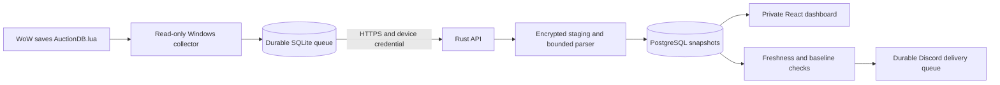

# Nauctions

Private shared Auction House history for WoW Forever. Nauctions is a Windows Tauri app with a bundled collector and React interface. It connects to the shared Rust API and PostgreSQL history. Players install the desktop app; they do not run a local database or API server. The browser interface remains available for remote access.

Build the Windows installer with `./scripts/desktop.ps1`, or run development mode with `./scripts/desktop.ps1 -Dev`. Read [desktop setup and architecture](docs/desktop.md). The shared backend must be reachable before players can sign in.

Desktop 0.4.0 adds signed updates through GitHub Releases. Existing users must install the new setup executable once. Later releases can be installed from App updates. Release preparation creates a draft after automated checks; publish it only after the applicable [release trials](docs/release-validation.md) pass. Read [release preparation](docs/desktop.md#prepare-a-release) for signing-key storage and build commands.

The [first release audit](docs/project-release-audit.md) records the verified GitHub state, local checks, ingestion fix, and open release gates. No stable release is available yet.

The recipe cost simulator is being developed separately. Keep release publication blocked until it is complete and the final revision passes the release gates. Desktop and collector hardening, CI checks, and disposable installation trials can proceed in parallel.

Shared-history writes are disabled in 0.4.0 pending the recovery fixes in the [sync audit](docs/ahdb-sync-audit.md) and real-client validation. Normal read-only collection and `sync --dry-run` remain available. Earlier write-sync instructions below describe the implemented feature, not an enabled release capability.

Desktop 0.2.0 starts quietly with the user's Windows session. Paired collectors resume automatically, read saved AHDB data while the selected WoW installation is open, capture its final save, then enter standby. Startup and automatic collection can be disabled in Settings.

Desktop 0.3.0 joins the group with a nickname and the invitation code `COPAINS`. Windows DPAPI protects the remembered membership so ordinary members do not need a password or repeat sign-in after restarting the app. The API and desktop must both be updated for this flow.

**Release status:** the local stack is implemented and tested with synthetic data. Client **1.60.1.70630** is not released. No real game scans are available. Do not use synthetic tests as proof of game compatibility. Recorded scans have unknown completeness by default, so they cannot trigger opportunity alerts. The release gates remain open.



## Repository

| Path | Purpose |
|---|---|
| `crates/domain` | Exact rational prices and canonical identities |
| `crates/ahdb-format` | Safe Lua data reader and `ahdb-inspect` command |
| `crates/analysis` | Snapshot metrics, Paris calendar days, baselines, and signals |
| `crates/collector` | Windows discovery, stable reads, SQLite queue, DPAPI credentials |
| `crates/game-process` | Selected-installation process detection and final-save grace periods |
| `crates/server` | Axum API, invitations, sessions, ingestion, and workers |
| `crates/storage` | PostgreSQL-only SQLx dependencies |
| `web` | Shared React interface for Tauri and browser access |
| `desktop` | Windows Tauri shell, native API transport, tray, and collector controls |
| `db/migrations` | PostgreSQL schema |
| `deploy`, `scripts` | Containers, local setup, packaging, backup, and restore |
| `fixtures` | Clearly marked synthetic source data |

## Run checks

Use PowerShell. Install Rust and Node.js 22 or later with npm. Docker Desktop must use Linux containers for the PostgreSQL tests.

```powershell
cargo test --workspace --locked
cargo clippy --workspace --all-targets --locked -- -D warnings
cargo fmt --all -- --check
Push-Location web
npm ci
npm test
npm run build
Pop-Location
./scripts/integration-db.ps1
```

The database test uses a new random schema. It checks authentication, upload receipts, replay, normalization, alerts, and revocation. The regular workspace command does not run this database test; `integration-db.ps1` runs it explicitly.

Inspect a synthetic file without a server:

```powershell
cargo run -p ahdb-format --bin ahdb-inspect -- --input fixtures/synthetic-v6.lua
```

## Run locally

Follow [the operations guide](docs/operations.md). Start PostgreSQL with `./scripts/dev.ps1 -DatabaseOnly`. Build `web` with the commands above. Set the documented environment variables, then run `./scripts/dev.ps1`. Open the exact `PUBLIC_ORIGIN` hostname; `localhost` and `127.0.0.1` are different browser origins.

Use a separate development database and synthetic realm until real source verification is complete. Keep `TRUST_RECORDED_SCAN_COMPLETENESS=false`. Do not set a Discord webhook during an unapproved test.

The first server start can create an administrator from `BOOTSTRAP_ADMIN_LOGIN` and `BOOTSTRAP_ADMIN_PASSWORD`. Remove the bootstrap password from the deployment environment after this account exists. Invite other members from the dashboard. Each member creates a short-lived device pairing code.

Build the collector ZIP with `./scripts/collector-package.ps1`. Users do not need Rust to run the packaged executable. Follow [collector setup](docs/collector.md). Normal collection remains read-only. The optional `sync` command backs up and merges shared AHDB history while WoW is closed; `sync-and-start` then starts the selected local game executable.

Enable **Record full scans** in AHDB, save the setting, and close every WoW client before synchronization. Specify the realm and faction explicitly. Use `--dry-run` first. Imported history is marked so it cannot become a new contribution on the next save; original full scans continue to upload.

```powershell
.\market-collector.exe --data-dir "$env:LOCALAPPDATA\Nauctions" sync --realm 'My Realm' --house Alliance --dry-run
.\market-collector.exe --data-dir "$env:LOCALAPPDATA\Nauctions" sync-and-start --realm 'My Realm' --house Alliance --game-exe 'C:\Games\WoW\WoW.exe'
```

## Data rules

- Prices are asking prices, not sales. All prices include observation time and quality.
- No-buyout auctions do not become free inventory. Snapshot quantities are never added across contributors.
- Unit prices remain rational values. The JSON price fields are decimal strings to preserve all integer digits in browsers. Display rounds only after calculation.
- An identical canonical scan is stored once. Secondary presenters remain in provenance.
- Daily AHDB imports remain UTC summaries. They do not supply artificial scan-level history or alert baseline coverage.
- Notifications require fresh eligible evidence. Discord cannot guarantee exactly-once delivery. An uncertain send outcome remains visible and is not automatically resent.

See [compatibility gates](docs/compatibility.md), [implementation status](docs/implementation-status.md), and [the supplied backlog](docs/implementation-backlog.md). Production credentials, hosting, offsite backup configuration, real-client testing, and the two-player pilot remain release work.
