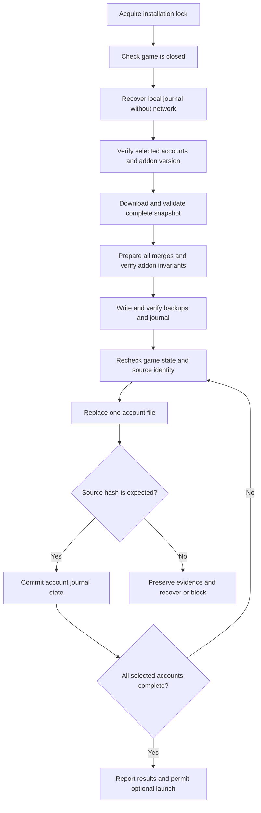

# AHDB reverse sync audit — 28 October 2026

Decision: do not enable reverse sync for friends yet. Keep normal collection available. The code has useful protection, but recovery and compatibility have release blockers.

Scope: local discovery, stable reads, authenticated history export, merge, backup, Windows replacement, journal recovery, desktop actions, and current tests. No real game file was read or changed. This audit does not change runtime behavior.

## Findings

### 1. High — a failed replacement can remove the source filename

Evidence: `crates/collector/src/sync.rs:85–108, 295–297`.

`ReplaceFileW` receives a null backup path. Any failure returns an error. Cleanup then deletes the temporary file if it still exists. Microsoft documents error 1176 as a case where the replaced file no longer exists when no backup path was supplied. Error 1177 can also leave an intermediate state. The earlier private backup helps, but the code does not restore the source or verify its state.

Effect: WoW can next start with no `AuctionDB.lua`, although a private recovery copy still exists. The test that uses a missing temporary file covers an early failure only. It does not prove that all replacement failures retain the source.

Required change: supply a unique replacement backup on the same volume. Keep the private backup too. After success or failure, inspect source, temporary, and replacement-backup hashes. Do not delete recovery files until the state is known. Restore only when the source is missing or matches the operation's known output. Preserve an unknown source for review. Block app-controlled launch until recovery completes.

Source: [Microsoft ReplaceFileW documentation](https://learn.microsoft.com/en-us/windows/win32/api/winbase/nf-winbase-replacefilew).

### 2. High — recovery misses missing files and needs the server first

Evidence: `crates/collector/src/sync.rs:187–251`.

Recovery runs only inside the loop over files returned by discovery, after the HTTP request. A missing source is not discovered. The journal stores a hashed relative path, new hash, and backup path, but no recoverable source path or original hash. Recovery checks only that the backup is a file. If the current source differs from the new hash, the journal is deleted without classifying the state. Network failure prevents this recovery pass altogether.

Required change: recover journal entries before discovery and network access, including entries whose source is absent. Store installation identity, account-relative path, original hash, output hash, backup hashes, temporary paths, and operation state. Verify backup contents. Retain unresolved records. Offer a local restore command and desktop restore action. Apply the same closed-game and path checks to restore.

### 3. High — accepted output can be invalid for the addon

Evidence: `crates/ahdb-format/src/lib.rs:708–713, 879–889`; `crates/ahdb-format/tests/merge.rs`, test `initializes_missing_house_and_history_fields_without_touching_other_fields`.

An existing house such as `Alliance={custom=-3.5e-2}` is accepted. Merge adds `items` and `daily` but leaves `scans` absent. Upstream `recentDay` evaluates `#house.scans`. `House` initializes fields only when the entire house is absent. Thus our parser accepts output that can cause a Lua error when the addon uses retention. Output validation currently uses the same parser as input validation.

Required change: validate the complete writable house schema. Refuse malformed existing houses, or initialize missing fields only under an explicitly supported migration. Run the pinned addon history code in a Lua test harness against generated files. Verify numeric item-key lookup, retention, tooltips, compaction, and the next native scan. Restrict writes to tested addon versions and SavedVariables roots.

Sources: pinned [History.lua](https://github.com/mooreatv/AuctionDB/blob/9a92cb047819fbf35219df58ef5dd3e6a28602c4/AuctionDB/History.lua) and [AuctionDB.lua](https://github.com/mooreatv/AuctionDB/blob/9a92cb047819fbf35219df58ef5dd3e6a28602c4/AuctionDB/AuctionDB.lua).

### 4. High — the default target can include unrelated accounts

Evidence: `crates/collector/src/sync.rs:188–201`; `desktop/src/collector.rs:242–270`.

The CLI selects every discovered account unless `--account` is supplied. The desktop does not expose this option. History can contain no realm evidence, so matching the requested server market does not establish the local account's realm. A realm-less account can receive the selected market and a durable marker without proving that this market is correct for that account. A later failing account does not undo earlier updates.

Required change: select accounts explicitly. Bind each account to a verified installation, realm, and house. Show the actual local account and path in preview. Validate and prepare all selected accounts before the first replacement. Report each account's outcome. Keep a recovery record per account; do not claim that multiple file replacements are one atomic transaction.

### 5. High — locking and process checks leave concurrency gaps

Evidence: `crates/collector/src/sync.rs:115–129, 182–186`.

The lock belongs to the collector data directory. Two commands with different data directories can update the same installation. The final source comparison and replacement are separate operations. Process detection is a snapshot and cannot prevent a manual game launch after a check. A lock alone also cannot stop WoW, which does not share the collector's lock.

Required change: serialize all writers with a Windows mutex keyed to canonical installation identity. Cover recovery, sync, restore, and app-controlled launch. Use file handles and Windows sharing restrictions where compatible with replacement; test the exact sharing behavior. Recheck game state and source identity at commit. Let the source settle after game exit. Keep the write interval short. Document the residual manual-launch race; do not promise that polling eliminates it.

### 6. Medium — server time can cause destructive retention

Evidence: `crates/ahdb-format/src/lib.rs:625–629, 794, 842–846`.

`generated_at` can be any positive exact Lua integer. It is also the retention clock. A far-future value can roll up recent local points and remove all local daily history. There is no comparison with a trusted or bounded current time. An old response can also shift retention backward. Conflicting duplicate export records use first-wins insertion rather than rejection.

Required change: validate snapshot freshness and future skew before any write. On a large clock disagreement, stop sync and keep the original. Give the export a snapshot ID, schema version, scope, creation time, counts, and content digest. Reject conflicting duplicate identities. Use a stable snapshot for any paginated response. TLS remains necessary; a digest alone does not authenticate the sender.

### 7. Medium — daily history can silently discard better server coverage

Evidence: `crates/ahdb-format/src/lib.rs:765–789, 841–842`.

Local daily data overwrites server daily data for the same item and UTC day, regardless of coverage. An existing daily entry also prevents rolled recent observations from contributing to that day. For example, one local scan wins over a server aggregate of twenty scans. This avoids some double counting but does not produce complete shared history. It differs from upstream's daily merge policy.

Required change: define an explicit policy for overlapping daily aggregates. Use scan identities to recompute a union when available. If overlap is unknown, keep separate provenance and choose a documented result; do not add counts blindly. Test subsets, disjoint scans, conflicting values, and repeated imports. Require a second identical sync to produce identical bytes.

### 8. Medium — export can stop working as data grows

Evidence: `crates/server/src/export.rs:143–145, 196–198`.

The server limits raw observation rows before daily compaction. More than 100,000 rows produces an error even when the final compact history would be small. The daily-import query counts overlapping source copies before selecting one per item and day. This fails before local replacement, so it is an availability issue rather than source corruption.

Required change: compact and deduplicate before the response budget, or provide bounded pages from an immutable snapshot. Validate the complete snapshot before any game-file write. Test a representative populated market, including duplicate daily imports.

## Required update flow

An offline or invalid server response must leave game files unchanged. Unknown local changes must never be overwritten by automatic recovery. A failed update must leave a verified original or a verified merged file available at the game path whenever recovery can safely establish that state.

## Release acceptance

1. Inject failure after each backup, journal, temporary write, replacement, and database commit boundary. Restart and verify recovery without network access.
2. Inject Windows replacement errors 1175, 1176, and 1177. Test antivirus sharing failures, read-only files, disk full, and missing or corrupt recovery files.
3. Run two sync processes with different data directories against one installation. Verify that only one can write. Test source changes and game launch during preparation and commit.
4. Run pinned addon Lua functions on each generated fixture. Test missing tables, unsupported versions, numeric keys, duplicate identities, future timestamps, daily overlap, and output size limits.
5. Test the exact released game and addon: launch, tooltip values, scan, reload, logout, restart, marker preservation, and restore. Verify settings, trust data, and native full scans.
6. Run a two-computer pilot for at least two days. Include account switching, offline sync, interrupted updates, and a restore performed through the user interface.
7. Enable reverse sync only for verified versions after these checks pass. Provide a switch that disables writes while normal collection continues. Keep verified backups until the user has checked the next game save; define a storage budget without deleting unresolved recovery data.

## Validation performed

- `cargo test -p ahdb-format --locked`: 7 merge tests and 12 parser tests passed as part of the combined run.
- `cargo test -p market-collector -p market-game-process --locked`: 16 collector tests and 4 process tests passed outside the filesystem sandbox. The first sandboxed run denied Windows replacement in temporary fixtures; the unrestricted run resolved both failures.
- Read the pinned upstream addon source and Microsoft replacement failure semantics.
- No database-backed server integration suite, real game save, or fault-injection suite was run. Findings 1, 2, 4–8 follow from code paths and documented contracts; they are not claims of observed damage to a real installation. Finding 3 is also exercised by an existing accepted-output fixture.

Existing strengths: bounded reads, stable-read checks, HTTPS with redirects refused, market checks, data-only Lua parsing, exact original-byte backup, temporary-file flush, final source comparison, and imported-history loop suppression. These are a sound base. They do not establish a failure-proof system.
