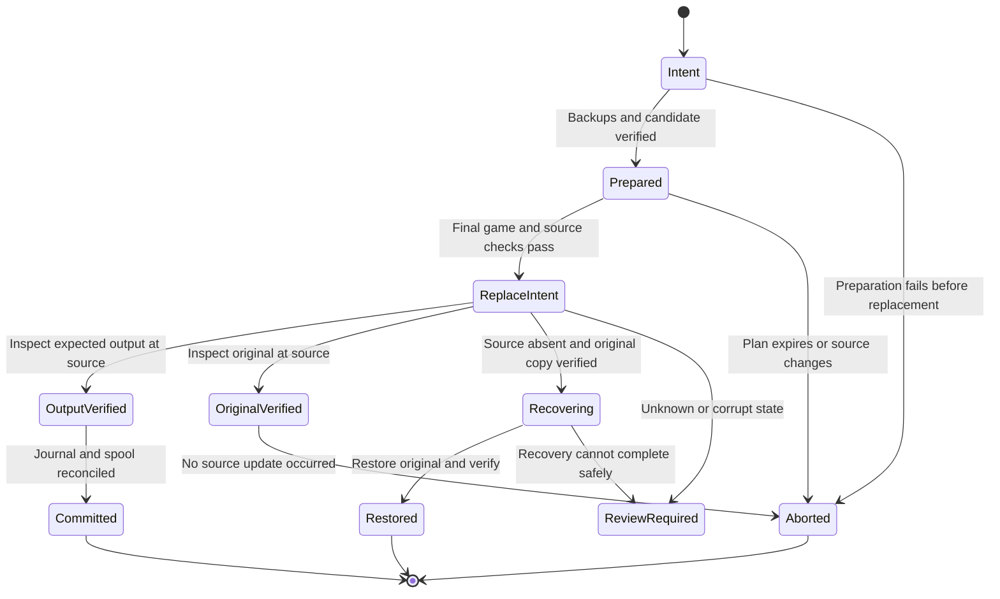
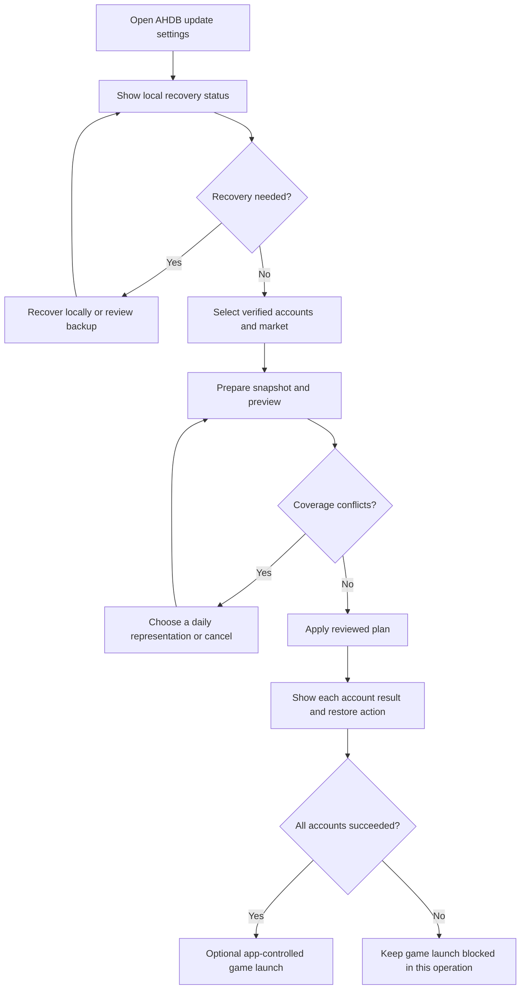

# AHDB update hardening: implementation plan

Date: 29 October 2026. Status: partial implementation; release writes remain disabled.

Current progress: [the implementation update](ahdb-sync-hardening-update.md) records local recovery, restore, installation locking, explicit account preview, addon fingerprints, protocol 2, and PostgreSQL compaction tests. These changes replace the earlier implementation status below where applicable. The full plan remains incomplete; public apply stays disabled.

Follow-up: strict selected-house checks and the synthetic bundled-addon roundtrip now implement part of H06/H12. The merger refuses missing tables, nonnumeric item keys, malformed scan sequences, unsupported writable roots, conflicting export duplicates, and incompatible daily summaries. It retains local data older than the import retention window. See [compatibility checks](compatibility.md#tests-available-before-game-access). This does not complete H06: installed-addon fingerprint enforcement, a validated adapter registry, and all output invariants remain required. H02-H05, the version 2 protocol, the rest of the matrix, and H13/H14 remain open. Do not infer safe release writes from these checks.

This plan resolves all eight findings in [the AHDB sync audit](ahdb-sync-audit.md). It applies to the Rust collector, shared export API, parser and merge code, Windows desktop, and release pipeline. It supersedes the implementation details of E10-06 for reverse sync. Existing upload and analysis work remains outside this change unless a task below names it.

The target is a recoverable update system with measured compatibility. No application can guarantee recovery from loss of every backup, a failed disk, or an uncontrolled game launch at any instant. The system must detect uncertainty, preserve evidence, and stop writes. Do not describe it as failure proof in the product.

## 1. Required behavior and design decisions

| ID | Requirement |
| --- | --- |
| R01 | Keep reverse sync disabled by default until the release gates pass. Enforce this in the collector as well as the desktop. Read-only collection continues. |
| R02 | Require an explicit account selection and a verified installation, realm, and house binding. Never select all accounts by default. |
| R03 | Recover interrupted local operations before new downloads or writes. Recovery must work without a valid server token or network connection. |
| R04 | Before replacement, keep a verified original in the private data directory and a verified original beside the source. Retain both until the operation has a known outcome. |
| R05 | After each replacement attempt, inspect the file state. A Win32 return value alone does not establish success or safety. |
| R06 | Never replace an unexpected current file during automatic recovery. Never discard an unresolved journal or its recovery files. |
| R07 | Validate the entire selected batch before the first source replacement. Commit one account at a time. Stop the batch on the first commit failure. |
| R08 | Only write a complete, validated, fresh snapshot. Never apply individual network pages directly to game data. |
| R09 | Test generated data with the pinned addon code as well as the Rust parser. Never execute user SavedVariables as Lua in the production collector. |
| R10 | Preserve unrelated bytes, native full scans, settings, trust data, other houses, and the game's own `.bak`. |
| R11 | Deduplicate recent observations deterministically. Never add daily scan counts when overlap is unknown. Show unresolved coverage conflicts before apply. |
| R12 | An identical source and snapshot must produce identical bytes. An immediate repeat sync must not create another backup or upload. |
| R13 | Serialize sync, restore, recovery, and app-controlled launch across collector data directories. Coordinate background acquisition with replacement and checksum commits. |
| R14 | Keep offline local restore available when reverse sync is disabled. A restore must itself have a journal and a backup of the current file. |
| R15 | Report an outcome for each account. Distinguish no change, updated, restored, deferred, partial batch, and review required. Never display batch success after a partial update. |

Product decisions for this release:

- Reverse sync remains an explicit user action. Do not add scheduled or login-time imports.
- An apply action uses a prepared local plan. It does not silently regenerate that plan after files change.
- A missing or malformed existing house is refused. Do not add implicit schema repairs. Add support for a new house only as a separately tested adapter feature after the initial release.
- Ambiguous conflicting daily summaries block apply until the user chooses which complete daily summary to retain. Both alternatives remain in recovery artifacts. A larger scan count alone does not prove a superset.
- Sync does not delete local history merely because it is absent from the server. Do not trim local history to satisfy a size limit. Normal addon retention remains active; imported data must use the tested recent/daily layout.
- Use additive server migrations and a new export protocol. Do not break normal uploads from older collectors.
- The existing marker permits one synced realm/house per saved file. Keep that restriction for this release. Do not promise that the same account file can be reverse-synced to both factions without a separately versioned marker migration.

## 2. Coverage of the audit

| Audit finding | Primary tasks | Required proof |
| --- | --- | --- |
| A1: replacement failure can remove the source name | H03, H04, H12 | Missing-source recovery and Win32 errors 1175/1176/1177 |
| A2: incomplete journal and network-dependent recovery | H02, H03, H05 | Offline recovery, corrupt backup, unknown source, legacy journal |
| A3: parser accepts addon-invalid output | H06, H12, H13 | Pinned Lua harness and real save/reload evidence |
| A4: unrelated account targets and partial batches | H07, H09, H10 | Explicit selection, market evidence, full preparation, partial result UI |
| A5: locks and process checks leave races | H02, H04, H09, H12 | Two data directories, background reader, game launch, path substitution |
| A6: unchecked server time and conflicting records | H08, H09 | Freshness, clock jumps, duplicate rejection, complete snapshot validation |
| A7: daily coverage is lost silently | H08, H09, H10 | Provenance, conflict choices, no count inflation, repeat stability |
| A8: export limits apply before compaction | H08, H11, H12 | More than 100,000 raw rows and overlapping daily imports |

H01 controls exposure throughout implementation. H14 controls packaging and rollout.

## 3. Components and file changes

Keep network, merge, and filesystem behavior separate. The collector orchestrator must call explicit operations rather than one closure that owns every stage.

| Area | Existing files | Planned additions or changes |
| --- | --- | --- |
| Collector orchestration | `crates/collector/src/sync.rs`, `main.rs` | Split into `sync/{mod,model,coordinator,journal,recovery,windows_fs,prepare,apply,restore,report}.rs`. Keep CLI dispatch thin. |
| Shared contracts | `crates/domain/src/lib.rs` | Versioned export manifest, page, provenance, error, and merge-report types. Put detailed definitions in modules if needed. |
| Parser and merge | `crates/ahdb-format/src/lib.rs`, `tests/merge.rs` | Separate read compatibility from writable schema validation. Return a merge report with the candidate bytes. |
| Windows process state | `crates/game-process/src/lib.rs` | Reuse conservative process enumeration. Add a sync-specific closed/settled gate; keep read-only capture behavior unchanged. |
| Server | `export.rs`, `ingest.rs`, `worker.rs`, `main.rs`, `migrations.rs` | Capability negotiation, immutable snapshot creation and page access, provenance, feedback tests, feature policy. |
| Database | `db/migrations/` | Add the next unused migration number for snapshot metadata/pages and provenance. Register it in `migrations::embedded`. Do not edit applied migrations. |
| Desktop | `desktop/src/collector.rs`, `main.rs`, `updates.rs` | Typed commands for accounts, preview, apply, recovery, restore, and operation status. Coordinate application updates with active sync. |
| Web interface | `web/src/DesktopShell.tsx`, `desktop.ts` | Account selection, preview, conflict resolution, progress, per-account results, and offline restore. |
| Tests and packaging | `.github/workflows/ci.yml`, `desktop.yml`, `release.yml`, `scripts/collector-build.ps1` | Fault tests, Lua harness, large export checks, protocol compatibility checks, and release evidence. |
| Documentation | `docs/collector.md`, `compatibility.md`, `api.md`, `desktop.md`, `operations.md`, `implementation-status.md` | Replace current broad safety claims with verified behavior and recovery instructions. Link this plan from E10-06. |

All added file names are proposed targets. Confirm existing names and migration numbers when each task starts.

## 4. Installation coordination and durable data

### 4.1 One coordinator for one installation

Create a coordinator at `<installation>/WTF/.nauctions-sync/`. This path is independent of `--data-dir`. Store a schema version, root identity, coordinator journal, operation manifests, and binding records there. Store no bearer tokens there. The normal collector remains read-only unless a user explicitly sets up reverse sync or requests recovery.

Acquire `writer.lock` through a Windows handle with no sharing. Hold that handle through recovery, preparation, apply, checksum reconciliation, and optional app-controlled launch. An existing lock file is not a stale lock: only handle ownership matters. Do not delete it to gain access. A process exit releases ownership. A lock timeout returns `installation_busy` without game-file changes.

Use the canonical root's volume identity and directory file ID as installation identity. Store the display path separately. Resolve aliases before choosing the coordinator; reject reparse points, junctions, network paths, and unsupported filesystems for the first write-capable release. Initially support tested local NTFS installations only. If the coordinator cannot be opened with normal user rights, refuse reverse sync. Do not request administrator access as an automatic repair.

A local mutex can improve desktop responsiveness, but the installation lock is authoritative across data directories and Windows sessions. Test access from a second Windows user; if permissions prevent safe coordination, return an unsupported-sharing error rather than using a second coordinator.

Background acquisition must acquire the same lock briefly for source capture and source-checksum transactions when a coordinator exists. It must not hold the lock during upload HTTP calls. Continue upload processing when source reads are deferred. A new collector must not read and enqueue a just-imported file before apply records its imported checksum.

When a second data directory first sees an exact output hash recorded by a verified committed installation operation, it records that hash in its own source state without queuing imported bytes. Native game rewrites remain eligible for normal capture. The server's marker and fingerprint rules remain the final feedback protection. Do not reuse or change legacy remote source IDs as part of installation identity migration.

### 4.2 Journal records

Use SQLite with full synchronous commits for the coordinator. Keep its schema separate from the private upload spool. The journal records installation operations, not authentication state. Retain terminal operation history; mark entries resolved instead of deleting them immediately.

| Record | Required fields |
| --- | --- |
| Operation | UUID, schema version, operation type, batch ID, installation identity, binding ID, adapter ID, collector version, timestamps, phase, last error, owner data-directory reference |
| Target | Validated account-relative path, original volume/file ID, original size/mtime/hash, expected output size/hash, snapshot ID and digest, selected conflict decisions |
| Artifacts | Unique source-side temporary path, unique source-side original copy, unique `ReplaceFileW` backup path, private backup path, artifact sizes/hashes, manifest path |
| Reconciliation | Original-upload staging receipt in the local spool, imported-output checksum state, source ID used by each known spool, result and recovery reason |
| Binding | Installation identity, account path, realm, house, evidence type and hash, adapter identity, explicit user confirmation time |

Paths in local journals are not trusted instructions. Validate them on every use. Reject traversal, absolute account paths, alternate data streams, unexpected names, reparse points, and root identity changes. Do not derive a missing source path from an arbitrary backup filename.

Write a bounded per-operation manifest before the first source mutation. Include validated relative paths and artifact hashes. Flush it and verify it by reopening it. The manifest permits discovery if the private spool is absent. A corrupt coordinator database triggers review using intact manifests; it does not authorize blind reconstruction or silent source replacement.

### 4.3 Artifact creation order

1. Commit operation intent and predetermined unique artifact paths.
2. Create the private original-byte backup with `create_new`. Flush, reopen, and verify its size and SHA-256.
3. Create a second original-byte copy beside the source. Flush, reopen, and verify it. This copy exists before replacement and is independent of the optional Windows replacement backup.
4. Write the merged candidate beside the source. Flush, reopen, verify the hash, and rerun output validation.
5. Persist the complete manifest and `prepared` phase. Prepare every selected account before committing any account.
6. Stage all changed accounts' exact original files in one private upload-spool transaction before the first replacement. Reuse an existing identical staged/accepted checksum where valid. A quota or staging error rolls back this staging transaction and leaves every source unchanged. Do not hold the spool transaction during filesystem replacement or HTTP calls.
7. Persist `replace_intent` before the OS call. Supply another unique same-volume path as the `ReplaceFileW` backup. Never use `AuctionDB.lua.bak`.
8. Inspect resulting files, persist the observed outcome, reconcile the spool checksum, and only then mark the account committed.

If any step fails, retain all artifacts required to identify or recover the outcome. Cleanup cannot run solely because a function returned an error.

## 5. Update state machine and recovery rules



On startup and before any writer or app-controlled game launch, inspect unfinished installation operations. A status or preview request can inspect and report recovery needs but must not restore a game file. An explicit apply/recover/restore action may perform recovery after the closed-game check. Missing sources must be addressed from journal targets, before normal file discovery.

Filesystem observations override stale phase labels. Recovery must be idempotent, including a crash during recovery itself.

| Observed source | Verified recovery artifacts | Action |
| --- | --- | --- |
| Expected merged hash | Manifest and output validation valid | Reconcile source checksum and mark committed. Do not replace again. |
| Original hash | Original identity or documented replacement identity consistent | Mark aborted or recovered-original. Keep original. Reconcile staging state without a new upload UUID for identical queued bytes. |
| Missing | At least one valid original copy for this operation | After game/path checks, publish a verified original through a same-directory temporary file using a no-overwrite rename. Verify the resulting source. Mark restored. |
| Missing | No valid original copy | Mark `recovery_required`; preserve all files and block app-controlled launch. |
| Any unexpected hash, empty file, or invalid candidate | Any | Preserve current source and artifacts. Mark `review_required`. Never overwrite it automatically. |
| Expected output but backup missing | Output is valid | Report committed output with degraded backup health; block the next update until backup protection is restored. Do not destroy valid output. |
| Game running or detection unknown | Any | Perform no repair writes. Report deferred recovery. Continue permitted read-only status and upload processing. |

A recovered account does not resume a partially completed batch automatically. Require a new preview for remaining accounts. A multi-account batch is not an atomic filesystem transaction. Keep completed accounts and report the partial result. Do not roll back successful accounts automatically.

## 6. Commit protection and restore

Before every source mutation, verify installation identity, account binding, adapter identity, game state, artifact hashes, source hash, and source file identity. For normal apply, compare against the prepared source. For restore, compare against a new explicit restore preview. Refuse all unknown states.

Implement a Windows filesystem adapter behind a small injectable interface. Expose file open/identity/read, durable artifact write, replace-with-backup, no-overwrite publication of a missing file, and inspect. Do not expose a generic overwrite helper to the orchestrator.

Run a Windows sharing-mode experiment before finalizing the adapter. An open source handle that denies writes can conflict with the access requested by `ReplaceFileW`; do not assume both can remain active together. Record the tested access/share matrix. Use the narrowest compatible access, retain directory identity handles, revalidate after any necessary handle closure, and inspect after replacement. Do not use a truncate-and-copy fallback if replacement fails.

The initial settle gate requires five consecutive seconds with closed process state and stable size/mtime/hash, sampled at least twice. Reset the gate after any change or unknown state; time out after 60 seconds. Use a monotonic timer. Tune these defaults only with measured game-save evidence. They reduce races; they do not prevent an external game launch.

Keep the current conservative block on any recognized WoW executable for write operations. Include the selected executable's image name and path. Detection errors stop writes. Test target-client naming before enabling its adapter. Never kill a game process or inject into it.

After any `ReplaceFileW` result, inspect source, candidate, and both source-side original artifacts. Handle documented errors 1175, 1176, and 1177 through the same observed-state classification. If the source is absent and the game remains closed, attempt original recovery immediately. If game state becomes unsafe, retain recovery files and report the unresolved state. App-controlled launch stays blocked.

Restore is local and does not need pairing. The user selects a recorded backup, sees its date/account/hash and the current file comparison, then applies. If a current file exists, back it up and journal the restore before replacement. If it changes after preview, refuse restore and generate a new preview. There is no unattended `--force` option for an unknown file.

## 7. Writable addon compatibility

Add an adapter registry. Each adapter declares installed addon file fingerprints, allowed `.toc` metadata, supported product/version family and API/schema requirements, exact SavedVariables root, full-scan and metadata formats, writable house schema, key types, marker policy, and tested retention functions. Detect and record the current build automatically. Do not require one permanently fixed numeric game build or mark a new build as validated from its number alone. A version string alone is insufficient for a modified or development checkout.

An update must validate both the installed addon files and the source data. The first adapter is restricted to the pinned Forever schema in `docs/compatibility.md`, after actual client validation. Other roots can remain readable but are not writable. Revalidate fingerprints at commit. Missing or changed addon files invalidate the prepared plan and binding until reverified.

For the selected house, require `items`, `daily`, and a dense `scans` sequence with adapter-valid rows. Reject missing tables, holes, malformed timestamps, mixed numeric/string item aliases, unsupported history shapes, multiple candidate roots, or realm conflicts. New writes use numeric item IDs. Existing string-only history keys are refused by this adapter rather than silently retained as apparently valid numeric lookup data.

Verify output invariants separately from syntax parsing: unrelated source spans unchanged; native full-scan bytes and fingerprints unchanged; marker scope unchanged or correctly added; strict point ordering; daily UTC keys valid; count/price/quantity bounds valid; no duplicate identity; final size and decoded-record limits respected.

Build a test-only Lua harness with the pinned addon history and initialization functions, stubbed game APIs, and a compatible interpreter. Run only checked-in synthetic or sanitized fixtures. Record provenance and applicable upstream notices for fixture code. Exercise `House`, `RecentHistory`, `StoredDaily`, `DailyHistory`, `LastPrice`, `Typical`, `CompactHistory`, and the next scan append. Include addon initialization and serializer/reload tests. The real client remains the authority for game-specific serialization behavior.

## 8. Export protocol, time, and daily provenance

### 8.1 Version 2 contract

Add authenticated snapshot endpoints under `/v1/collector/history-snapshots`. The API prefix remains stable; the export schema is version 2. Keep the legacy endpoint only for a controlled transition. Capabilities advertise supported export schemas, minimum writer build, feature policy, adapter policy version, and authoritative server time.

| Operation | Contract |
| --- | --- |
| `POST /history-snapshots` | Validated realm/house and supported schema; returns a ready manifest or a bounded failure. One active snapshot per device; repeated request ID is idempotent. |
| `GET /history-snapshots/{id}` | Returns the immutable manifest to its authorized owner. |
| `GET /history-snapshots/{id}/pages/{index}` | Returns exact stored page bytes. Check active membership and snapshot ownership for every page. |
| `DELETE /history-snapshots/{id}` | Releases a completed/abandoned snapshot; retries are safe. |

The manifest includes schema and merge-policy versions, snapshot UUID, market, generation/expiry times, retention layout, record counts, page count, each page's exact byte length and SHA-256, aggregate content digest, and provenance mode. Define the aggregate digest as SHA-256 over an ordered, length-prefixed list of page digests; use test vectors shared by server and collector. Hash the actual transferred page bytes. Decimal strings retain integer precision.

Materialize snapshot pages from one PostgreSQL repeatable-read transaction. Do not run separate page queries against changing live data. Publish only after all pages, manifest, and feedback-suppression fingerprints are committed. Cap execution time and rollback incomplete snapshots. Expiry cleanup removes snapshot pages, not feedback provenance needed for later upload suppression.

Initial limits: 1 MiB per page, 256 pages, 128 MiB complete snapshot, 1,000,000 exported records including provenance entries, one active snapshot per device, and a 512 MiB server-wide active snapshot budget. Snapshots expire after 15 minutes. Use a 30-second page-request timeout and a five-minute total preparation deadline. Reject excess capacity explicitly; never return a silently truncated export. Final SavedVariables must still fit the current 32 MiB and 500,000 decoded-record limits, including preserved local data. Measure and revise limits before pilot if representative data cannot fit.

New clients refuse legacy export for writes. Older clients must not receive a hazardous legacy export once the hardened server is deployed: return an actionable upgrade-required response from the legacy endpoint. Normal upload endpoints remain supported.

### 8.2 Freshness rules

- Capture local UTC and monotonic time when snapshot preparation starts. Obtain current authenticated server time from fresh capabilities and compare it with local UTC. Refuse skew greater than five minutes.
- Accept snapshot generation no more than five minutes before the fresh server-time observation and no more than five minutes into its future. Require expiry after generation and before the protocol's 15-minute maximum lifetime.
- Before apply, fetch current policy/time again. Reject expired snapshots, disabled writes, minimum-version failure, or a local wall-clock jump greater than five seconds relative to monotonic elapsed time. Local recovery remains available when this network check fails.
- Every observation timestamp must be positive, no later than generation, and within the declared export window. Reject inconsistent daily keys, zero scan counts, values beyond exact Lua bounds, bad count relationships, or malformed numeric strings.
- Collapse byte-equivalent duplicate identities. Reject conflicting values for one snapshot identity. Do not let first-record ordering decide the result.
- Use the validated snapshot time for imported recent/daily layout. Do not use it to delete local historical data. A repeated identical snapshot must preserve the same layout.

### 8.3 Merge policy

Use exact scan fingerprints plus market scope for provenance when available. Timestamp alone is not proof that different accounts observed the same scan. If the addon can represent only one point per item/timestamp, choose the local point on a conflicting recent timestamp and report the excluded server alternative. Keep the alternative and decision in the merge report; never sum quantities for simultaneous snapshots.

For each item and UTC day:

| Inputs | Required behavior |
| --- | --- |
| Exact recent-point duplicates | Keep one. |
| Raw observations with known membership and no incompatible daily aggregate | Deduplicate the union, then roll it up with the pinned addon rules. |
| Identical daily summaries | Keep one; do not double counts. Record that identical values do not establish identical membership. |
| Same known coverage set, different values | Stop with a provenance-integrity error. |
| Proven subset/superset | Keep the verified superset aggregate or recompute from its known raw members. |
| Proven disjoint raw members | Recompute one daily aggregate from the raw union. Do not claim exact medians from summary medians alone. |
| Different daily summaries with unknown/partial overlap, or daily plus unaccounted recent rows | Create a conflict. Default apply is blocked. The user can choose one complete daily representation for that day in preview. Never add unknown counts. |

For a resolved daily conflict, output exactly the selected daily representation and exclude unaccounted recent rows for that same item/day from the candidate. Preserve excluded alternatives in the verified operation artifacts. Display the coverage tradeoff before apply. Persist decisions keyed to the exact input hashes and policy version; changed data requires a new decision.

Maintain a local merge ledger linked to the output hash and snapshot digest. It records imported provenance and conflict decisions. It is not authority to overwrite a changed game file. After addon compaction or a native save, reuse only provenance that can still be proven; otherwise classify overlap as unknown. This conservative rule must not be weakened to avoid a conflict dialog.

Retain the existing scope marker format where compatible with older parsers. Keep imported history excluded from new contributions while preserving native full scans. Register fingerprints for the actual generated/selected output where needed; test marker loss and addon compaction. Do not count an export download or a merged upload as new market evidence. If the pinned addon drops the marker and reliable fallback cannot prevent feedback after compaction, keep that adapter write-disabled.

## 9. Export scalability

Remove the raw 100,000-row refusal as the main export budget. Select canonical observations and deduplicate daily imports in SQL before applying final output limits. Apply realm, house, source quality, variant exclusion, and time filters first. Preserve the existing distinction between unknown and trusted complete scans; hardening must not promote scan quality silently.

Stream bounded rows or aggregate in SQL rather than `fetch_all` of the full market. Compute exact lower medians, minimum positive price, half-up average quantity, latest timestamp, and coverage counts with tests matching addon rules. Preserve provenance needed by section 8; do not discard it to make an ambiguous aggregate look complete.

Add indexes only after examining the execution plans for market/time/source filters and item/day selection. Set a 60-second snapshot-build statement budget. Use configured concurrency and active-byte budgets. A budget error produces no local write and an actionable retry result.

Benchmark at least 250,000 raw observations and 250,000 overlapping daily-import rows, with final compact output below limits. Repeat at ten times the expected pilot data. Verify stable snapshot contents while ingestion proceeds. Record query time, build time, peak memory, page bytes, and database storage. On a documented CI reference machine, require the compact benchmark to complete within the 60-second budget and configured memory limits. Exceeding final capacity is an explicit supported failure, not a truncated history.

## 10. CLI and desktop flow

Add typed JSON results. Human output can format the same result. Include operation ID, phase, stable error code, retry class, per-account outcome, counts, conflict decisions, and local backup references. Never include tokens or raw character names in remote health messages.

Proposed CLI additions:

```powershell
market-collector sync-accounts --json
market-collector sync-bind --account ACCOUNT --realm REALM --house Alliance
market-collector sync --account ACCOUNT --realm REALM --house Alliance --dry-run --json
market-collector sync-apply --plan PLAN_ID --json
market-collector sync-recover --json
market-collector sync-backups --account ACCOUNT --json
market-collector sync-restore --operation OPERATION_ID --dry-run --json
market-collector sync-restore --plan RESTORE_PLAN_ID --json
```

`--account` can repeat for an explicit batch. Reject omitted accounts on all write/preview commands. Do not provide an implicit `--all`. The existing `sync-and-start` command must use the same prepared-plan engine and gates. Deprecate direct blind sync; a compatibility invocation can prepare and display a plan, but cannot bypass account choice or unresolved conflicts.

Account binding requires compatible addon files and realm evidence from a saved full scan for the selected house, with explicit confirmation in the UI. A realm-less file without such evidence remains read-only; instruct the user to save a native full scan first. Binding is invalid after installation identity, account location, realm evidence, server origin/market, or adapter identity changes. Keep operational evidence locally.



The UI shows account folder/path, realm/house evidence, addon status, snapshot age, before/after file size, recent/daily additions, coverage conflicts, preserved alternatives, and backup status. It reports expired plans as requiring a new preview. It does not expose hashes and protocol internals as mandatory product decisions.

Cancel is available during preparation and between account commits. Once replacement intent is durable, cancellation completes observed-state recovery before returning. Closing the window must not abruptly terminate an active commit. A desktop update/restart must wait for a safe terminal phase or decline with an operation-in-progress message. A killed process is handled by startup recovery. Restore stays visible offline and after pairing is revoked.

Use stable errors such as `game_running`, `game_state_unknown`, `installation_busy`, `source_changed`, `addon_unsupported`, `market_unverified`, `snapshot_expired`, `clock_mismatch`, `daily_conflict`, `backup_invalid`, `storage_full`, `recovery_required`, and `upgrade_required`. Each message states whether a file changed and the next permitted action.

## 11. Work packages, dependencies, and acceptance

Estimates are focused engineering days including task-specific tests and documentation. They are planning ranges, not delivery commitments. One day means approximately six focused hours. External access and pilot waiting time are excluded. All tasks are required for release unless a later decision explicitly changes scope.

| Task | Work | Depends on | Estimate |
| --- | --- | --- | --- |
| H01 | Write gates and protocol policy | None | 1-2 days |
| H02 | Installation coordinator and path/lock identity | H01 | 2-3 days |
| H03 | Durable journal and offline recovery | H02 | 3-5 days |
| H04 | Windows replace adapter and observed-state commit | H03 | 3-5 days |
| H05 | Legacy migration and offline restore | H03, H04 | 2-3 days |
| H06 | Writable schema adapter and Lua harness | H01 | 2-4 days |
| H07 | Explicit account and market bindings | H02, H06 | 1-2 days |
| H08 | Version 2 snapshot and provenance contracts | H01 | 2-3 days |
| H09 | Deterministic merge and prepared batch engine | H03, H04, H06, H07, H08 | 3-5 days |
| H10 | Desktop preview, conflict, recovery, and result flow | H05, H07, H09 | 2-4 days |
| H11 | Scalable snapshot materialization and API | H08 | 3-5 days |
| H12 | Fault, race, and full integration release suite | H05, H09, H10, H11 | 3-5 days |
| H13 | Exact client compatibility and two-PC pilot | H12 | 1-2 engineering days plus pilot time |
| H14 | Packaging, rollout, and operational handoff | H13 | 1-2 days |

Total: 29-50 engineering days before contingency. Add 20% contingency for Windows sharing behavior and real-client differences. Prototype H04 sharing semantics and capture H13 source evidence early; keep public write enablement blocked until final H13 acceptance. Independent work packages can be scheduled concurrently, but their dependency gates still apply.

### H01: write gates

Add server write-policy/minimum-client capability and a collector policy gate. Keep local recovery independent of server feature policy. The desktop reads the gate but does not enforce it alone. Gate defaults are off, including old config files. A developer-only temporary-installation mode supports automated tests and cannot write outside its fixture root. Retire legacy reverse-export access during rollout; document that a remote switch cannot stop an older binary holding previously downloaded data.

Acceptance: direct CLI calls, desktop calls, missing policy, demo market, unsupported version, and disabled policy all refuse new sync writes. Offline restore remains possible. Existing read-only collection tests still pass.

### H02: coordinator

Implement root identity, installation lock, shared discovery, bounded lock wait, path validation for existing and missing targets, and acquisition coordination. Check parent handles when a source is missing; current `safe_path` requires an existing file and cannot serve as the recovery validator.

Acceptance: different data directories and path aliases cannot create concurrent writers; abandoned processes release handles; reparse substitutions, alternate streams, root moves, and permission failures stop writes. A second background reader defers source capture during commit and resumes afterward.

### H03: journal and recovery

Implement phases, manifests, artifact hashes, idempotent transitions, and the full recovery table. Recovery enumeration starts from coordinator records and manifests, not only discovered `AuctionDB.lua` files. Reconcile imported-output checksums in the private spool without erasing pending original uploads.

Acceptance: restart with network disabled and expired/revoked/missing credentials recovers a missing source when safe. An unexpected current file remains byte-identical. A corrupt backup is never restored. Missing private spool does not hide unfinished installation operations. SQLite or manifest corruption produces an explicit review state.

### H04: replacement

Implement and record the tested Win32 share-mode matrix. Create/verify source-side originals before replacement, pass a unique Windows backup path, and classify file state after every result. Preserve ACL/error details. Add settle checks and launch gating.

Acceptance: injected 1175/1176/1177 states produce original, committed output, or an explicit unresolved state with retained artifacts. No cleanup deletes the last verified original. A source change after preview aborts. No generic copy-overwrite fallback exists. Tests cover actual Windows APIs in temporary directories, not only mocks.

### H05: migration and restore

Migrate the current `sync_journal(source,new_hash,backup)` conservatively. For each row, inspect known selected roots and enumerate account directory entries even if the source file is absent. Recompute the legacy path hash from candidate relative paths. Only associate an unambiguous exact match; do not reverse or guess a hash. Verify the backup and candidate output. Keep unmapped rows intact and block new writes for the affected configured installation pending review. Never silently delete an old row.

Add restore preview/apply and a backup browser. Back up any current file before an explicit restore. Preserve the original upload queue and credentials through migration. Refuse an older writer against a newer coordinator schema. During upgrade, stop old collector processes; filesystem locks cannot coordinate an already running old writer that ignores the new protocol.

Acceptance: old empty/current/pending/corrupt journals and missing sources have migration fixtures; upgrade interruption is recoverable; re-running migration changes nothing; offline restore survives another interruption. Downgrade instructions never delete coordinator files or use the old writer on that installation.

### H06: compatibility

Implement the adapter registry, write-specific validator, pinned harness, and output invariants in section 7. Change the current permissive missing-house tests into explicit refusal tests. Keep read parsing support broad where safe.

Acceptance: a house without `scans` is refused before backup or replacement. Missing/malformed tables, wrong `.toc`, modified Lua files, wrong global, wrong key type, and unsupported formats stop writes. Accepted candidates pass the Lua harness and preserve unrelated bytes.

### H07: accounts

Add binding storage, explicit account options, account evidence results, and desktop invocation fields. Refuse conflicting scan evidence and realm-less histories without a qualifying native scan. Validate the whole selected batch before any commit.

Acceptance: one selected account never changes an unselected account. An account on another realm is refused. Old desktop config does not select every account. A failed preparation leaves every source unchanged.

### H08: contracts

Define manifest/pages, provenance identity, limits, digest vectors, freshness, merge policy versions, conflict choices, and structured errors. Add serialization tests with exact integer boundaries. Add documentation and compatibility cases before implementing both endpoints and client consumption.

Acceptance: server and collector share digest/decimal fixtures. Unknown schemas, unsupported policies, wrong scope, conflicting duplicates, invalid timestamps, and mixed snapshot pages are rejected.

### H09: merge and batch

Implement sections 8.2 and 8.3 as pure functions with an injected clock context. Return candidate bytes plus changes, exclusions, conflicts, provenance, and validation results. Store plans by UUID with source/adapter/binding/snapshot hashes and expiry. Apply must reject edited, expired, or stale plans. Classify no-change accounts before creating backup artifacts or staging uploads. Prepare every changed account's verified artifacts and stage the whole batch's originals before the first replacement, then commit in stable account order.

Acceptance: identical inputs give identical bytes; reordered network pages do not change output; immediate repeat is a no-op; daily counts never inflate on repeated imports; unknown overlap blocks until an exact-input decision exists. Changed account 2 after account 1 commits stops the batch and reports partial success without launching WoW.

### H10: desktop

Implement the flow and messages in section 10 using typed collector output. Use a cleanup guard so a failed child launch does not leave normal collection stopped. Resume collection only after operation reconciliation, with pending acquisitions coordinated through the installation lock. Coordinate application updater restart with active operations.

Acceptance: offline recovery/restore, conflict cancellation, expired preview, partial batch, collector spawn failure, window close, and update-during-commit are visible and safe. No success toast hides unresolved recovery. Add interaction tests around these state transitions.

### H11: server

Implement snapshot materialization, SQL deduplication/aggregation, ownership, budgets, expiry cleanup, capability policy, and feedback registration. Add forward migrations and register them. Retain authenticated membership checks for every access, including revocation during download.

Acceptance: section 9 benchmarks pass; one snapshot stays unchanged during ingestion; expired/foreign/revoked access fails; failed builds expose no ready manifest; interrupted downloads cause no game writes; more than 100,000 raw rows can produce a valid compact export.

### H12: release suite

Implement section 12. Treat injected failure tests as tests of persisted states, not assertions about private function call order. Run child-process termination tests at named durable checkpoints.

Acceptance: all required Windows, Linux server, desktop, Lua, migration, and performance checks pass on the same candidate commit. Every failure fixture checks source hashes, original preservation, journal state, and retry idempotence.

### H13: compatibility and pilot

Record exact game build, installed addon fingerprints, settings, account topology, and sanitized fixture hashes. Exercise native scan, merge, tooltip history, reload, logout, restart, another scan, and restore. Verify the durable marker and native full-scan contribution after addon serialization. Repeat with a second account and a second computer for at least two days.

Acceptance: expected in-game values match fixtures; no Lua errors occur; unrelated data survives; imported history does not become new evidence; restore works through the desktop; no unexplained journal or backup warnings remain. If the real client is unavailable, mark this gate pending and keep release writes off. Synthetic tests cannot complete it.

### H14: rollout

Update packaged instructions and release notes. Tie the exact desktop and bundled collector builds to the verified export protocol and adapter policy. Gate the release workflow on H12 artifacts and recorded H13 evidence. Re-audit findings A1-A8 and mark each closed only with linked tests/evidence.

Acceptance: a clean Windows profile can select an account, preview, apply, and restore without a terminal; an older client receives an upgrade instruction; disabling server writes prevents new updates while collection and offline recovery continue.

## 12. Required test matrix

| Suite | Required cases | Main location |
| --- | --- | --- |
| Crash recovery | Exit after intent, either backup flush, candidate flush, prepared manifest, replace intent, OS call, output inspection, spool update, terminal journal, cleanup, and each restore step | Collector child-process integration tests |
| Windows filesystem | Replacement errors 1175/1176/1177; access denied; sharing violation; antivirus-like held handles; full source/private disks; read-only file; long/Unicode paths; corrupt SQLite/manifest; missing/modified backups; hard links and reparse points | Collector Windows tests and disposable-volume harness |
| Races | Two data directories; two sessions; acquisition versus apply; source replacement after preview; start game during download/prepare/commit; changing addon files; installation path alias; updater restart | Windows integration tests and desktop tests |
| Recovery safety | Offline/revoked token; missing source; unexpected valid source; empty source; only one valid original copy; valid output with lost backup; crash during recovery | Collector recovery fixtures |
| Schema | Missing `scans`; sparse scan sequence; wrong root/version; mixed key types; conflicting realm; multiple roots; unsupported strings; exact-number boundary; oversized full output | Parser/merge tests and Lua harness |
| Merge | Equal/reordered points; same timestamp different prices; duplicate export conflicts; empty export; unknown daily overlap; proven subset/disjoint sets; raw-versus-daily overlap; repeat compaction/import; preserved old local data | Format property tests and golden fixtures |
| Protocol/time | Missing/out-of-order/replayed pages; mixed snapshot IDs; wrong digest/count/length; expiry; page revocation; timeout; huge response; local clock jump; future and stale server time; old schema/minimum client | Server and collector HTTP integration tests |
| Multi-account | Unselected account; wrong realm; invalid second account at preparation; source change during second commit; partial results; no automatic rollback or game start | Collector batch and desktop tests |
| Feedback | Upload original, import snapshot, upload rewritten file, compact in addon, upload again, append native full scan, revoke/re-pair device | `crates/server/src/sync_tests.rs` plus Lua and collector integration |
| Capacity | 250k+ raw rows; 250k+ duplicate daily imports; pilot scale times ten; final output over limit; concurrent snapshot budget | Server integration/performance job |
| Lifecycle | App closes, collector crashes, update is requested, account unpaired, root moved, cleanup runs, application downgraded | Desktop/packaging integration |

Simulated process death does not prove power-loss durability. Add a disposable Windows VM test for forced reset around replacement and journal commits. Record filesystem and storage configuration. Test actual disk-full behavior on disposable volumes; do not fill a developer's main disk. Unsupported or unmeasured storage remains outside the write allowlist.

Build checks to extend, not duplicate blindly:

```powershell
cargo fmt --all -- --check
cargo clippy --workspace --all-targets --locked -- -D warnings
cargo test --workspace --locked
cargo test -p market-server --locked -- --ignored
cargo test --manifest-path desktop/Cargo.toml --locked
cargo clippy --manifest-path desktop/Cargo.toml --all-targets --locked -- -D warnings
& 'C:\nvm4w\nodejs\npm.cmd' --prefix web test
& 'C:\nvm4w\nodejs\npm.cmd' --prefix web run build
```

The ignored server suite requires an isolated test database. Add named jobs for the Lua harness, crash checkpoints, disposable-volume checks, and protocol skew. Run Windows tests on Windows; Linux stubs cannot establish replacement correctness. Use Bun only if the required npm/Node tools are unavailable and the repository workflow supports it.

## 13. Backup lifecycle and support

Before apply, estimate bytes for the complete batch: private originals, source-side originals, candidates, potential Windows backups, SQLite/WAL growth, and original upload staging. Check capacity on every involved volume and include a 64 MiB reserve per volume. Capacity checks are advisory; every write still handles full-disk errors safely.

Pin unresolved artifacts indefinitely. For resolved operations, keep the newest three verified original versions per account and all versions younger than 30 days. Use a 1 GiB per-installation backup budget as the initial default. If required retention exceeds the budget, stop new updates and show cleanup/export choices. Never delete protected recovery data to fit the budget. Report actual retained bytes in settings.

Cleanup acquires the installation lock, verifies operation state and remaining valid copies, and removes only files named by completed manifests. It never deletes arbitrary matching `.bak` or `.tmp` files. Do not remove a prepared plan's only original or candidate. Keep audit metadata after eligible payload cleanup.

Support export includes collector/desktop/adapter versions, operation IDs, phase transitions, error codes, redacted account IDs, sizes, and hashes. It excludes credentials and raw SavedVariables by default. Local account paths stay local unless the user explicitly exports them. A support bundle must not be necessary to restore a known original.

## 14. Delivery sequence and release gates

1. **Containment:** H01. New write paths are off. Publish the limits and keep collection usable.
2. **Local safety:** H02-H05. Demonstrate offline recovery and restore in disposable Windows fixtures before integrating new server data.
3. **Data correctness:** H06-H09 and H11. Demonstrate addon-valid output, explicit accounts, deterministic merges, and immutable complete snapshots.
4. **User operation:** H10. Demonstrate preview, conflicts, partial results, cancellation, and restore on a clean profile.
5. **Candidate validation:** H12. All automated suites pass for the exact packaged candidate.
6. **Real compatibility:** H13. Exact client/addon evidence and the two-PC pilot pass.
7. **Limited enablement:** H14. Enable only the tested adapter and invited pilot clients. Observe each result before adding more friends. Any source-loss, unexplained Lua error, feedback loop, or recovery mismatch disables new writes immediately.

Rollback means disabling new imports and using the hardened local recovery/restore tool where required. It does not mean reinstalling an old unsafe writer, deleting journals, or automatically rolling every account back. Keep server migrations additive so stopping snapshot service does not stop uploads. Preserve old artifacts during application upgrades and uninstall prompts.

Completion requires: all eight audit findings have a test-backed resolution; all tasks are complete; no unresolved installation operations remain in the pilot; the packaged build has real addon compatibility evidence; the desktop restore path has been used successfully; and documentation states the residual manual-launch and storage-failure limits accurately.

## 15. References and planning validation

- [Audit and original evidence](ahdb-sync-audit.md).
- [Windows ReplaceFileW contract](https://learn.microsoft.com/en-us/windows/win32/api/winbase/nf-winbase-replacefilew): backup placement and documented intermediate failure states. Do not use the unsupported replacement write-through flag as a durability solution.
- [Windows CreateFileW contract](https://learn.microsoft.com/en-us/windows/win32/api/fileapi/nf-fileapi-createfilew): access and sharing compatibility. The sharing-mode experiment is a required implementation gate.
- [PostgreSQL transaction isolation](https://www.postgresql.org/docs/current/transaction-iso.html): use one stable transaction snapshot during materialization. The project currently tests PostgreSQL 16; validate SQL and isolation behavior on that supported version.
- [Pinned addon schema and outstanding real-client evidence](compatibility.md).

Planning validation on 29 October 2026: re-read the current collector sync, merge, export, capability, desktop invocation, migrations, and CI code; mapped every audit finding to implementation and acceptance work. This change creates the plan only. It does not rerun or claim completion of the proposed implementation tests.
