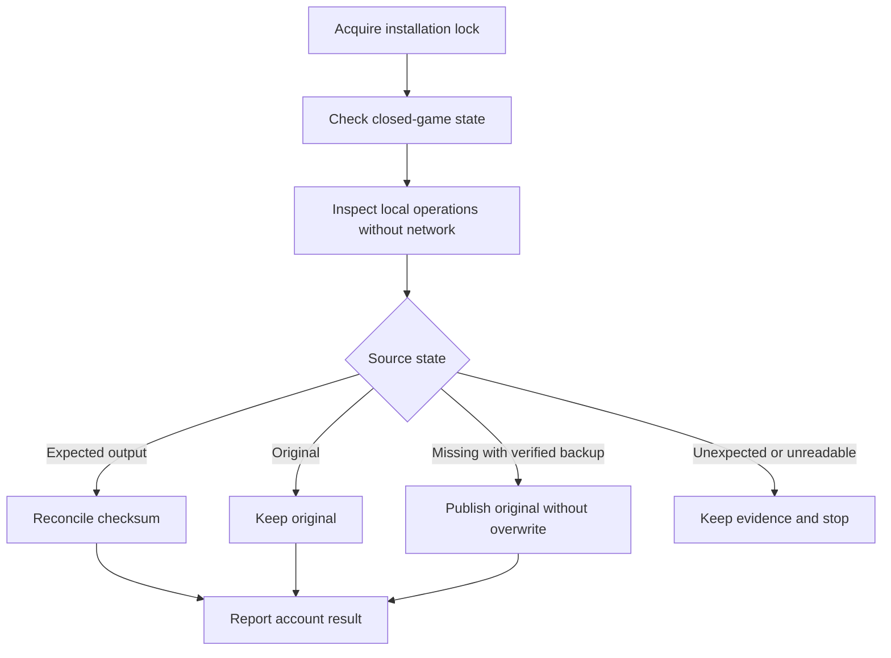

# AHDB write-path update — 29 October 2026

Status: the code changes below pass synthetic Windows and PostgreSQL checks. Shared-history apply and sync-and-start remain disabled. Forecast work has resumed through a separate addon cache export. This export does not write game history or SavedVariables. No real game file was read or changed.

This update follows [the audit](ahdb-sync-audit.md) and [the implementation plan](ahdb-sync-hardening-plan.md). It does not mark the full plan complete.

## Changes against the audit

| Finding | Current behavior |
| --- | --- |
| A1: replacement can remove the source name | The writer creates a private original, a source-side original, a candidate, and a unique Windows backup path. It verifies hashes and inspects source state after every replacement result. A missing source can be restored through a no-overwrite rename. Unknown bytes are retained. |
| A2: recovery needs discovery and the network | The installation journal stores the relative target path, installation identity, original/output hashes and sizes, owner directory, operation ID, type, and phase. A separate verified manifest retains the target and artifact identities. `recover --root` works without pairing or network access and finds missing sources through journal targets. Legacy records without a recoverable path stop for manual review. |
| A3: addon-invalid output | The existing strict writer refuses malformed house tables and unknown daily overlap. Preview and the internal writer check every bundled addon Lua file and the TOC against embedded fingerprints. The pinned Lua roundtrip checks reload, numeric lookup, retention, native scan append, and marker preservation. |
| A4: unrelated account selection | Preview and the internal writer require one explicit account. The desktop shows local paths and does not select an account automatically. The writer prepares that account before replacement. There is no default multi-account batch. |
| A5: concurrent writers | A Windows file handle with no sharing locks `WTF/.nauctions-sync/writer.lock`. Root volume and directory identity bind the coordinator. The root and target directory handles prevent directory relocation during commit. The source handle denies in-place writes and permits replacement. Capture shares the lock across data directories and defers without stopping pending uploads. |
| A6: unsafe snapshot time | Protocol 2 carries one immutable history response, a content-derived snapshot ID, SHA-256, counts, generation time, and expiry. The collector checks these before merge and commit. It rejects clock skew over five minutes and wall-clock jumps during preparation. Old collectors receive HTTP 426. |
| A7: ambiguous daily coverage | Differing daily summaries with unknown overlap stop with a conflict. Raw daily aggregates and imported summaries must agree. Counts are not added. The current response does not provide an interactive conflict-resolution editor. |
| A8: raw row limit | PostgreSQL deduplicates and compacts historical observations before the final 100,000-record response limit. Daily imports are deduplicated before that limit. A repeatable-read transaction fixes the source view for the complete response. The implementation uses one bounded response, with no network pagination. |

The private upload source IDs remain unchanged. A second data directory recognises an exact committed import and records its checksum without uploading imported output. A native rewrite remains eligible for normal capture. The server marker checks remain active.

## Recovery and restore

The desktop exposes recovery in the connection area before sign-in. Local recovery and restore do not need a server token. Restore compares the current source hash with the selected preview, backs up current bytes, and journals its own replacement. No force option bypasses a changed hash.

All retained operation files remain available. There is no automatic cleanup. A 1 GiB retained-artifact budget and free-space reserve stop additional preparation; they do not delete recovery evidence. Missing backup protection blocks another sync. A corrupt journal or mismatched manifest requires review.

## Verification

The following checks passed during this update:

- Workspace Rust tests, including the Windows collector tests.
- Windows replacement tests and simulated intermediate error states 1175, 1176, and 1177.
- Restart recovery with a missing source and no pairing, corrupt/missing backup refusal, unknown-source preservation, exact-hash restore, and preparation interruption cases.
- Independent-process lock contention, second-spool import suppression, and capture deferral while a writer holds the lock.
- PostgreSQL ingestion, recipe, and shared-history integration tests in isolated schemas.
- Large export: 100,001 canonical observations compact into daily rows; 100,001 identical daily imports produce one representation; differing summaries return a conflict.
- Six web test files with 29 tests, and the production web build.
- Desktop Rust tests: 23 passed; the signed-installer trial remains ignored because it needs a release package.
- Bundled addon tests: 16 passed. The two-player synthetic Lua/Rust history roundtrip also passed.

Format checks and clippy with warnings denied passed for both Rust workspaces. Test-generated artifacts are under `artifacts/offline-sync/`; these are synthetic evidence.

## Remaining release evidence

Do not enable shared-history apply yet. These checks still need the actual client or a dedicated Windows test environment:

1. Run save, reload, scan, restart, marker retention, and local restore with the exact game and addon package.
2. Run the two-computer pilot for at least two days.
3. Test forced reset, actual disk full, antivirus interference, and second-Windows-user permissions.
4. Test the residual manual-launch race and record supported filesystem and client conditions.
5. Complete the remaining plan work for durable account bindings, explicit conflict choices, server apply-policy revalidation, and release enablement. These are prerequisites to a public apply path; the current public command remains disabled.

The sharing tests establish behavior for normal Windows replacement and simulated failures. They do not prove power-loss durability or every intermediate Windows failure state. An external launcher can start after process inspection. The implementation preserves evidence and refuses uncertain states; it cannot prevent that external action.

The Windows replacement and sharing rules follow [ReplaceFileW](https://learn.microsoft.com/en-us/windows/win32/api/winbase/nf-winbase-replacefilew) and [CreateFileW](https://learn.microsoft.com/en-us/windows/win32/api/fileapi/nf-fileapi-createfilew).
