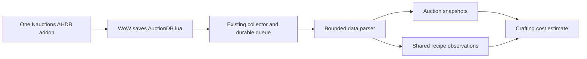

# Shared crafting costs

Nauctions accepts discovered recipe facts from its AHDB fork. External catalogue
imports, client-table extraction, character profiles and learned-recipe tracking
are out of scope for the shared catalogue. The in-game profit window reads learned
and readiness state locally while the player's own profession is open. It does
not save or upload that character state.



## Collection and storage

The addon discovers recipes from auction browse results, item-search results,
full auction scans, and profession windows. It saves facts under
`NauctionsProfessionsSaved` in the existing addon file. The collector keeps its
current discovery, stable reads, credentials, upload UUIDs and receipts. Uploads
can contain auctions, professions, or both. Invalid sections reject the whole
upload before data is committed. Replay is idempotent.

Migration `0005_professions.sql` creates `professions`, `recipe_versions`,
`recipe_reagents`, `recipe_outputs` and `recipe_observations`. Recipes use spell
IDs. Inputs and outputs use base item IDs. Immutable observations retain build,
locale, addon version, capture time and upload provenance. Missing recipes in a
later capture do not delete earlier discoveries.

Migration `0006_auction_recipe_discovery.sql` adds immutable
`recipe_item_observations`. An optional `recipe_items` section records each recipe
item's base ID, observed time, candidate crafting spell ID, and resolution status.
`resolved` requires corresponding recipe facts in the same export. Other statuses
are `mapping_unavailable`, `details_unavailable`, and `ambiguous_spell`. A pending
item alone is a valid contribution. It does not create a recipe or a cost estimate.
Unknown item classes are retried locally and are not labelled as recipe items.

Structured teaching-spell IDs take precedence over use spells. Full schematic
identity must match the candidate spell. Missing data gets bounded retries;
pending recipe items survive reload and retry on later observations or manual
capture. No purchase, learning action, or automatic auction query is performed.
Discovery is shared and does not record whether a character knows the recipe.
The Crafting page shows total auction recipe items and the unresolved count.

The default selection uses the newest observed build for each spell. Different
economic facts in the same build cause a conflict and pause profit estimates.
A known yield can refine an otherwise matching unknown yield. Known binding can
refine missing binding. Contradictory known binding observations also pause profit.

## API

The addon also provides `/ahdb crafting` and a **Crafting profit** button above the
native profession window. It ranks the open profession's known recipes by profit
per craft and offers a **Ready now** filter. Native recipe-row hovers and resolved
recipe-item tooltips show AH material costs and output asking prices. The addon
uses the latest local scan of one selected auction house. It does not use the web
quote endpoint. See [in-game controls and limits](../addon/AuctionDB/README.md#in-game-crafting-profit).

All routes require an existing member session.

| Route | Use |
|---|---|
| `GET /v1/professions` | Profession list and discovered recipe counts |
| `GET /v1/recipe-items` | Auction item discoveries; filters: `build`, `limit`, `offset`; returns unresolved count |
| `GET /v1/recipes` | List; filters: `q`, `profession_id`, `build`, `limit`, `offset` |
| `GET /v1/recipes/{spell}` | Selected recipe revision |
| `GET /v1/recipes/{spell}/quote` | Costs in the configured market |

Quote options: `market_id`, `build`, `crafts` (1–10000), `mode` (`reference` or
`purchase`), `fee_bps` (0–10000), and `additional_cost_copper` (whole copper for the
entire batch). Default fee assumptions are 5% for faction houses and 15% for Neutral.
Users can change them. They are not a verified Forever fee contract.

Collector capabilities advertise `profession_export_schemas: [1]`.

## Calculation rules

- Use one listing snapshot in one market. Do not fill missing inputs from another
  scan. Return snapshot ID, time, coverage quality and freshness.
- Match exact plain item keys such as `i123`. Do not select an arbitrary variant.
- Exclude bid-only listings. Prices are asking prices, not sales.
- Reference mode multiplies the lowest observed unit ask by required quantity.
- Purchase mode buys whole stacks in ascending unit-price order. It reports
  insufficient supply and includes the cash cost of surplus units. It does not
  solve for the cheapest possible stack combination.
- Use exact signed rational arithmetic. Serialize amounts as decimal strings.
  Round only for display. Negative profit is valid.
- Profit is sale value after the configured cut, less material and additional
  batch cost. Margin uses net sale value. Return on cost uses total cost.
- Missing material prices and unknown or variable yields block profit. Services
  and known bound outputs show material cost only. Unknown binding has a warning.
- A snapshot older than one hour has a stale warning. Unknown or partial coverage
  stays visible and does not establish complete supply.
- Deposits, failed listings, vendor prices, intermediate crafts and recursive
  make-or-buy decisions are not included. Inventory is not treated as free.

## Build and verify

Use PowerShell from the repository root:

```powershell
python -m pip install --target artifacts/lua-test-runtime -r scripts/requirements-addon.txt
python scripts/test-addon.py
cargo run -p ahdb-format --bin ahdb-inspect -- --input artifacts/addon-test-export.lua
cargo run -p ahdb-format --bin ahdb-inspect -- --input artifacts/addon-auction-test-export.lua
cargo test --workspace --locked
cargo clippy --workspace --all-targets --locked -- -D warnings
./scripts/integration-db.ps1
./scripts/addon-package.ps1
```

Run web tests and the production build with the root README commands. The Lua
suite compiles all packaged Lua sources and runs capture in a simulated Lua 5.1
client. Its generated export is accepted by the Rust parser. PostgreSQL tests
cover combined uploads, replay, conflicts, market scope, yields, fees, whole-stack
supply and snapshot isolation.

Auction tests also cover unlearned recipe discovery without a profession window,
duplicate auction rows, structured tooltip IDs, wrong use-spell wrappers,
unavailable metadata, reload recovery, pending-only uploads and replay. The
generated auction export passes through the production Rust parser in CI.

The package is `dist/nauctions-ahdb.zip`, with `AuctionDB` at the archive root.
Installation is manual and requires a backup. No installer changes game files.
Deploy the new server and migrations before installing the updated addon.
Real-client compatibility and the multi-player pilot remain release gates.

## Merchant sell prices

Merchant estimates use the sell price from addon observations first. A known zero
price means that the item cannot be sold. If the scan has no sell price, use the
same Classic tooltip data as the item hover: bundled tooltips first, or a saved
price from an on-demand tooltip request. Later scans with an empty sell price do
not remove a known price. Auction prices always come from the selected snapshot.

A sell price alone does not establish profit. The estimate also needs a fixed
output quantity and enough reagent supply. The Crafting list shows the reason
when the merchant estimate is unavailable.
