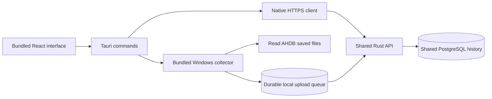
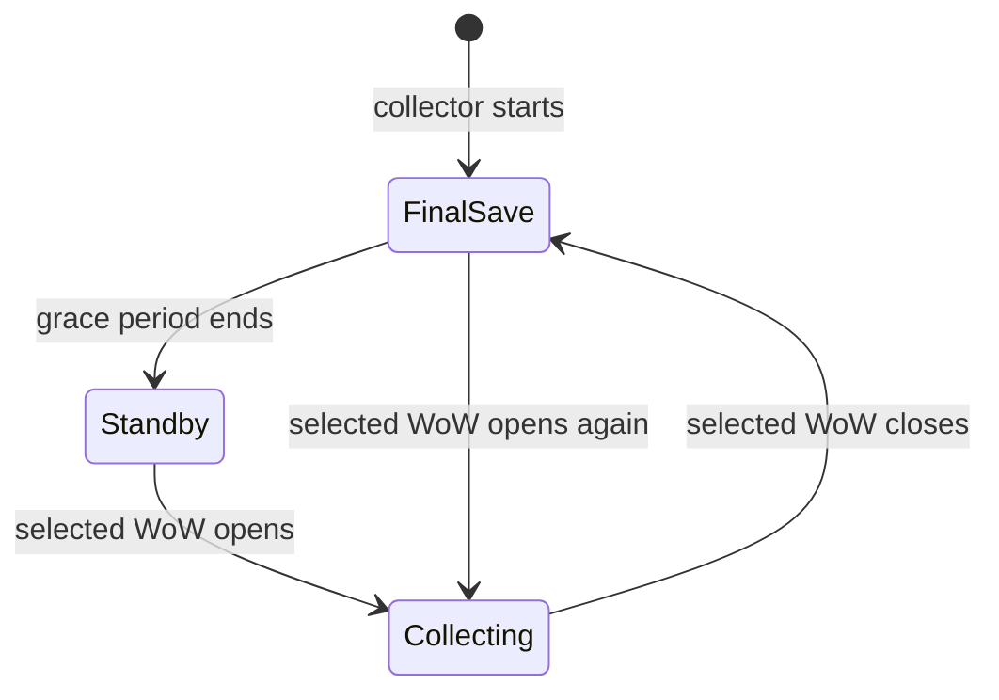

# Nauctions desktop

Nauctions uses Tauri 2 on Windows. The installer includes the React interface and the Rust collector. The shared API and PostgreSQL database stay on the server. The app does not start a local web server or database.



## Player setup

1. Install Nauctions from the Windows setup executable.
2. Enter the shared server origin, for example `https://market.example.com`. Use the server address supplied by the group administrator.
3. Choose a nickname and enter the shared invitation code `COPAINS`. Ordinary members do not need a login or password. The code is checked by the server.
4. Open Settings. Under This computer, choose the WoW folder that contains `WTF/Account`.
5. Select Pair this computer. The app requests a short-lived code and pairs the bundled collector.
6. Automatic collection starts after pairing. The collector checks the selected game's state about every ten seconds. AHDB must persist its data through reload or logout before a new scan is available on disk.

The release app registers a current-user Windows startup entry on its first launch. Windows starts it with `--background` after the user signs in. The window stays hidden and the tray menu remains available. The app restores its remembered membership. A paired collector resumes independently with its separate Windows DPAPI device credential. Development builds do not register startup automatically.

Closing the window hides the app in the tray. Use Open Nauctions in the tray to restore it. Use Quit Nauctions to stop the owned collector process and exit. Signing out stops collection and disables automatic collection until it is resumed. Pause collection also persists across app restarts. The Start with Windows and Automatic collection options are under Settings > This computer. The startup option reports the current Windows registration state. Startup errors are shown without preventing the rest of the app from opening.

The game-aware collector has four states:

| State | Behavior |
|---|---|
| WoW open | Read the selected installation's saved AHDB files and process uploads. |
| Final save | Continue reading for 60 seconds after the collector first observes the transition from running or unknown to closed. This permits the final logout save to finish. |
| Standby | Reconcile saved files to catch a missed session. Continue processing durable upload and receipt queues. |
| Detection unavailable | Keep reading conservatively. Do not claim the game is closed. |

At collector startup, a 30-second final-save check also captures a save made before the app opened. These timers use monotonic time. Process checks compare executable paths inside the selected installation, so another WoW installation does not count. Selecting an exact game executable makes detection more specific. The app reads process image paths only; it does not inspect game memory or trigger an auction scan.



Startup registration is updated when the executable location changes, such as after installation. The executable path is quoted, including when the installation folder contains spaces. An existing Task Manager disable is not overwritten on every launch at the same location. The NSIS uninstaller removes the Nauctions current-user startup entry. No administrator service or scheduled task is installed.

Check upload status reports the durable queue and source health. Retry pending uploads schedules queued data again. It does not force the server to accept rejected data.

## Shared-history sync

**0.4.0 release gate:** write sync and Sync and start are disabled in both the desktop and collector entry point. Preview remains available. Resolve the [sync recovery findings](ahdb-sync-audit.md) and game compatibility trials before enabling writes. The procedure below describes the gated feature.

The advanced sync section is under Settings > This computer. Select a game executable inside the selected WoW folder if you want to use Sync and start WoW.

1. Close all WoW clients.
2. Enable AHDB Record full scans.
3. Select Preview sync to inspect proposed changes without writing to the game folder.
4. Select Sync with backup to merge shared history, or Sync and start WoW to launch the selected executable after the merge succeeds.

The existing collector supplies game-process checks, exact market binding, backups, atomic file replacement, and import markers. The desktop wrapper does not bypass those checks. It pauses its background collector during these operations and resumes it if it was running. Do not launch WoW manually while sync runs. Demo markets cannot enroll collectors or use sync.

## Build and run

Use PowerShell. Development needs Rust, the Microsoft C++ build tools, Node.js with npm, and WebView2. End users do not need Rust or Node.js. The installer handles a missing WebView2 runtime with Tauri's standard bootstrapper.

```powershell
Push-Location web
& 'C:\nvm4w\nodejs\npm.cmd' ci
Pop-Location
./scripts/desktop.ps1 -Dev
```

Development uses the fixed frontend address `http://127.0.0.1:1420`. The server is configured separately in the app. For the existing local demo, use `http://127.0.0.1:8080`. The demo still requires the local development API to be running. The shared server address is listed in [connection instructions](connect.md).

Build the release installer:

```powershell
./scripts/desktop.ps1
```

The script builds the collector, copies it into the Tauri resources, builds the interface, and creates a per-user NSIS installer under `desktop/target/release/bundle/nsis`. It also copies the installer and a SHA-256 checksum to `artifacts/desktop`. Use `-DebugBuild` for a debug installer. Do not copy the desktop executable alone: it needs its bundled collector resource.

The desktop package has a separate Cargo workspace and lock file. This keeps Windows GUI dependencies out of the headless server build. Its resource executable and generated Tauri schemas are ignored. Commit `desktop/Cargo.lock`.

Checks after preparing the frontend and collector resources:

```powershell
cargo fmt --manifest-path desktop/Cargo.toml -- --check
cargo test --manifest-path desktop/Cargo.toml --locked
cargo clippy --manifest-path desktop/Cargo.toml --locked --all-targets -- -D warnings
Push-Location web
& 'C:\nvm4w\nodejs\npm.cmd' test
& 'C:\nvm4w\nodejs\npm.cmd' run build
Pop-Location
```

## Sessions and local storage

- The interface is bundled with the app. It does not load executable frontend code from the API server.
- Tauri commands send API requests through a native Rust client. The client retains session cookies in memory and sends the configured server Origin and existing CSRF token. Server-side member checks, origin checks, and CSRF checks stay enabled.
- The first join creates a normal member and a random credential. The app stores that credential with Windows DPAPI, bound to the exact server origin. A restart restores it without another nickname or code prompt. Passwords and the shared invitation code are not stored. Pairing persists separately through the collector's Windows DPAPI credential.
- Remembered sessions have a one-year validity. Active use renews the expiry when less than six months remain. Server-side member deactivation invalidates the credential. Explicit sign-out revokes the session and removes its encrypted local copy.
- Nicknames have 2–32 letters, numbers, dots, hyphens, or underscores. Existing nicknames are reserved without regard to case. The shared invitation code never retrieves another member's account. An existing remembered computer keeps its nickname; another computer must choose a new nickname. The code grants the member role only. Existing administrator password access remains under the collapsed Administration section.
- Only HTTPS server origins are accepted, except HTTP on loopback for local development. Embedded credentials, paths, query strings, and fragments are refused. Redirects are not followed. API paths cannot escape `/v1/` or select a different host.
- Changing the server stops collection and restores any membership remembered for that server. Collector queues and device credentials are stored in separate directories for each server.
- Desktop settings are under the Windows application-local-data directory for `app.nauctions.desktop`. They contain the server origin and selected local paths. Collector credentials remain DPAPI protected. Do not share the application data directory.
- A single-instance guard prevents duplicate desktop collectors. The app stops only its own child process. It does not stop a separately launched command-line collector.
- Remote pages cannot navigate inside the main window or open additional webviews. Broad filesystem and shell access are not exposed to JavaScript. External catalog links are currently blocked inside the app.

The browser interface uses the same nickname-and-code form with a persistent HttpOnly cookie and normal browser routes. The desktop uses hash routes so reload and history work with bundled assets. Item icons are bundled. Fonts use the local system fallback, with no Google Fonts request.

## App updates

Desktop 0.4.0 checks the stable GitHub Releases manifest when the interface starts. The App updates section also has a manual check. An available release shows its version and notes. Select **Download update and restart** to install it. The updater works before sign-in and does not need a market session.

The native updater uses HTTPS and verifies the download with the embedded release public key. It also verifies that the signed version matches the manifest version. The interface cannot supply a download URL or substitute a signing key. Downgrades are not enabled.

Collection continues during download and signature verification. Before installation, the app obtains the collector lock and stops its owned collector. A running collector action causes installation to fail with a retry message. The installer then exits the old app and starts the new version. The updater does not delete settings, membership, pairing, queues, or sync backups. These preservation claims still require the installation and upgrade trial in [release validation](release-validation.md).

Versions before 0.4.0 need one manual installation of the new setup executable. Later versions can update through the app. A server-only fix does not need a desktop update if the API remains compatible. Desktop interface and collector changes need a new desktop release.

### Prepare a release

The source repository and update host are `https://github.com/brunohanss/Nauctions`. The stable manifest is `https://github.com/brunohanss/Nauctions/releases/latest/download/latest.json`. Until the first stable release is published, update checks report an unavailable endpoint. Draft releases do not change the stable endpoint.

The release private key is stored locally in ignored `data/release/nauctions.key` and in the repository's `TAURI_SIGNING_PRIVATE_KEY` Actions secret. Keep an independent private backup of this key before distribution. Do not commit it, attach it to a release, or replace it during routine upgrades. The matching public key is in `desktop/tauri.conf.json`. Windows Authenticode signing is separate from updater signing.

1. Change the version in `desktop/Cargo.toml` and `desktop/tauri.conf.json`. Update `desktop/Cargo.lock` and `docs/release-notes.md`. Commit the change.
2. Run **prepare desktop release** in GitHub Actions for that revision. It runs software checks, creates a signed installer, and creates a draft release. A duplicate release tag causes failure.
3. Complete the applicable trials in [release validation](release-validation.md). Record the results and known limits in the draft release notes.
4. Publish the draft as a stable release only after acceptance. The release must include the installer, `.sig`, `.sha256`, `latest.json`, and `release-info.json`.
5. Check the public manifest, then check for updates from an older supported installation.

For a local signed build, set the private-key path without printing its content:

```powershell
$env:TAURI_SIGNING_PRIVATE_KEY = Join-Path $PWD 'data/release/nauctions.key'
./scripts/desktop.ps1 -SignedUpdate
```

Unsigned local builds remain available through `./scripts/desktop.ps1`. They are not suitable as updater artifacts. The release script records installer and collector hashes and the Git revision. If a published update is defective, withdraw it from the stable channel and issue a corrected, higher version. Do not replace a published version's installer with different bytes. Server rollback must account for database migrations.

## Settings recovery and collector logs

Desktop preferences are saved by atomic replacement. `desktop.backup.json` retains the previous valid preferences. Startup restores that copy if `desktop.json` is missing or damaged. Damaged copies are kept with a unique `.corrupt.json` suffix. When neither copy is valid, the app preserves the damaged files, starts with automatic collection and Windows startup disabled, and reports the recovery condition in the desktop status. Reconnect the server and check preferences before resuming collection. Membership files, collector pairing, and pending upload files are not replaced by this recovery.

The desktop drains collector output continuously and keeps `collector.log` plus `collector.log.1` in the selected collector directory. Each file is at most 5 MiB under normal operation. Rotation does not restart the collector. A log error is reported in desktop status; output pipes continue to drain so a log failure does not block uploads. An older oversized current log is truncated when the new desktop takes ownership of logging.

To build while a release executable is open from the normal target directory, use a separate desktop target:

```powershell
./scripts/desktop.ps1 -DesktopTargetDirectory artifacts/hardening-desktop-target
```

The script restores the previous Cargo target setting after the build. This option does not install the result or stop the open desktop app.

## Distribution limits

The installer does not yet have a Windows Authenticode certificate. Signed updater artifacts use the separate Nauctions update key. Production distribution still needs real-client compatibility evidence and installation and upgrade trials on another Windows computer. The shared API address is listed in [connection instructions](connect.md). Existing synthetic-data release limits still apply.

## Local validation

Desktop 0.2.0 also passed eight desktop tests, four process-detection and grace-period tests, the full Rust workspace suite, 17 frontend tests, formatting and strict lint checks. The process test detects the test executable in its own installation and rejects another root. The final-save test includes a delayed closed-state observation after network work. These checks do not replace a real WoW session or an actual Windows reboot.

On 28 October 2026, the release installer, five desktop Rust tests, 17 frontend tests, and strict desktop lint checks passed. Native review confirmed first-run setup, a readable offline error, server reconnection to the local demo, hide-to-tray behavior, and restoring the same process through a second launch. UI automation stopped at account sign-in. The installer was built but not installed. Real game collection and sync still need the existing live-client validation.
