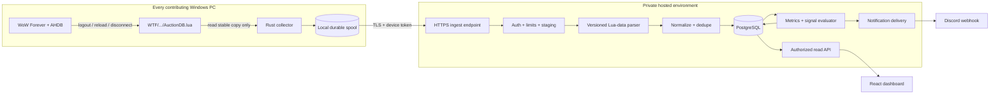
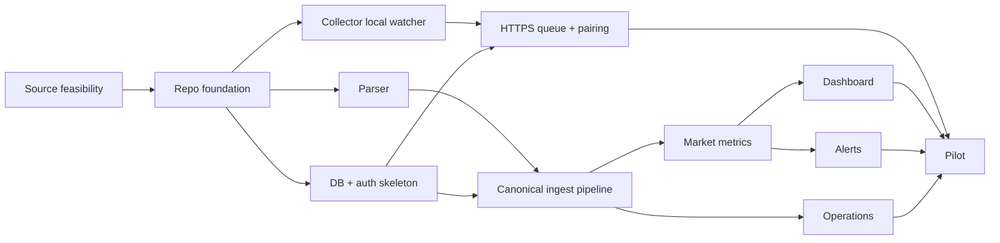

# WoW Forever — Private Shared Auction House Market Tracker
## Full implementation plan and engineering backlog

**Revision:** 1.0 — 27 October 2026  
**Status:** Implementation-ready proposal, subject to P0 feasibility gates  
**Scope:** One WoW Forever realm; one auction-house market/faction; a small invitation-only group using multiple computers, WoW accounts and characters.  
**Architecture decision:** Keep AHDB unmodified for the MVP. Install a small read-only Rust collector on each contributor's Windows PC. Upload to a private Rust API. Parse centrally, store in PostgreSQL, calculate market signals, and expose a React dashboard and Discord alerts.

> **How to use this specification:** The backlog uses stable ticket IDs, *MUST/SHOULD/MAY* priority language, dependencies, acceptance criteria, and test IDs. No source-code assumptions about the deployed Forever client are considered verified until P0. Estimates are ranges of focused engineering hours, not delivery commitments.

---

# 1. Product definition

## 1.1 Problem

Auction House information currently stays inside individual players' AHDB SavedVariables. A player who is logged out cannot automatically benefit from a friend's later scan, compare detailed history beyond addon retention, or receive external alerts. A WoW addon cannot make arbitrary internet connections or invoke a Rust executable. An external, opt-in client process must bridge locally saved data to an HTTPS service.

## 1.2 Product outcome

Five invited players can scan the same market through normal AHDB gameplay. Whenever their game writes its AHDB SavedVariables, the local collector detects and uploads newly saved observations. The central server indexes them, derives per-item histories and opportunities, and lets every authorized member inspect the data on a browser. New observations can trigger Discord alerts even if the alert recipient's game is closed.

## 1.3 Primary user journeys

| ID | Persona and trigger | Expected result |
|---|---|---|
| UJ-01 | Player joins the private group | Installs AHDB and collector; pairs one device; sees collector health |
| UJ-02 | Player scans AH and uses `/reload` or logs out | Saved data is uploaded exactly once, without editing WoW files |
| UJ-03 | Player loses internet after saving a scan | Upload stays queued and is retried without losing data |
| UJ-04 | Member opens dashboard while WoW is closed | Sees shared history and the last observation age |
| UJ-05 | Friend records a notably cheap listing | Eligible users receive one contextual Discord alert |
| UJ-06 | Admin removes a contributor | New uploads from that device are denied; prior valid market history remains |
| UJ-07 | Member has two WoW accounts | Both account SavedVariables are discovered and correctly attributed |
| UJ-08 | No one scans for many hours | Dashboard presents history as stale; no misleading live-price claim |

## 1.4 Goals, measurable outcomes

| ID | Requirement | Initial success condition |
|---|---|---|
| G-01 | Easy contribution | First Windows setup completes without installing Rust/Cargo or opening router ports |
| G-02 | Correct data | Prices, stacks and timestamps match manual fixtures and a sampled live scan |
| G-03 | No harmful file writes | Collector reads copies only; no changes to original AHDB SavedVariables |
| G-04 | Reliable ingestion | Retry and file re-read produce no duplicate accepted observation |
| G-05 | Shared market | Two independent accounts contribute to the same scoped market |
| G-06 | Traceable insight | Every presented price has observation time, origin and quality indicator |
| G-07 | Actionable alerts | Only fresh, sufficiently supported candidates notify a member |
| G-08 | Private access | Unauthorized read/write and revoked device access are rejected |
| G-09 | Recovery | Database and alert-state restoration procedure has been tested |

## 1.5 Explicit exclusions from MVP

- No replacement AH scanner and no custom AHDB fork.
- No automated WoW login, game interaction, scan initiation, bidding or purchases.
- No WoW memory reading, process injection, packet capture or bypass of game restrictions.
- No instant server data before WoW saves SavedVariables.
- No promise of confirmed sales or realized prices: snapshots only reveal asking prices and listings at observation time.
- No public API, multi-realm market comparison, mobile native client, crafting optimizer or trading bot.
- No external-service-to-WoW synchronization in the MVP.

## 1.6 Operational assumptions

- Windows 10/11 is the initial collector target; verify supported Windows versions during P0.
- One realm and one faction/auction-house scope. Persist a full `market_id` for future extension; do not combine Neutral with Alliance/Horde unless proven the same market.
- A small group (pilot 2–5; configurable up to ~10). Real traffic and file size determine final capacity.
- AHDB full scan recording is opt-in and must be validated for the deployed Forever release.
- Hosted API, database and notifications run independently of player PCs.
- The browser and collector use different credentials and permissions.
- All pricing is stored as **integer copper**. All instants are stored as UTC, and the dashboard may display Europe/Paris.

---

# 2. Evidence and assumptions register

## 2.1 Confirmed from upstream source at drafting time

- `AuctionDB/Record.lua` describes optional full scan recording. It writes `saved.ah` and item metadata `saved.itemDB_2`. Recorded scan objects include realm, faction/house, character, timestamp, counts, format version and encoded listing data. Forever full scan records omit seller names and use a time-left band. Full scan data format version appears as `6`, with item metadata version `5` in upstream code.
- `AuctionDB/History.lua` documents recent per-item entries `timestamp,min,median,quantity`. Recent history keeps up to 30 scans / 7 days; older UTC-day rollups are retained for up to 180 days. The addon computes a quantity-weighted median of unit buyouts.
- AHDBapp provides a legacy Go/MySQL importer and `ahdbmerge` for account/computer history synchronization. These are references, **not** the proposed upload API or production collector.
- WoW SavedVariables are written by the client at logout, disconnect, exit or `/reload` in normal operation.

## 2.2 MUST verify on a real Forever client (P0)

| ID | Open assumption / risk | Required verification |
|---|---|---|
| A-01 | AHDB loads, scans and saves correctly | Capture full scan on intended release client |
| A-02 | SavedVariables survive reload/relog | Run save → reload → read → restart test; inspect loading and serialization |
| A-03 | `Record.lua` format matches published code | Compare actual `ah` and `itemDB_2` samples with decoder |
| A-04 | Historical item key maps variants correctly | Collect test variants, enchant/suffix/key samples |
| A-05 | History is truly scoped to desired house/realm | Sample Alliance/Horde/Neutral metadata and avoid accidental merge |
| A-06 | Full scan memory and file size acceptable | Measure file size and WoW behavior at multiple retention counts |
| A-07 | Character/account name data can be omitted | Establish minimization and redaction strategy |
| A-08 | Full market scan completeness is knowable | Locate completion flags/counters in upstream data and test aborted scans |
| A-09 | AHDB updates and supported client versions | Pin baseline release and fixture hashes; define upgrade procedure |

**Important release risk:** A user reported on the Blizzard forums on 21 September 2026 that Forever beta client 1.60.1 wrote SavedVariables but failed to restore them on the next load. This is a report, not proof of the final release behavior. Treat A-02 as a stop/go test; do not design around an unverified workaround.

## 2.3 Architecture decisions

| ADR | Decision | Rationale | Revisit when |
|---|---|---|---|
| ADR-001 | Keep AHDB unmodified | Avoid rebuilding a mature scan feature | AHDB cannot supply required information |
| ADR-002 | One collector per contributing PC | Direct reliable local disk-to-HTTPS bridge | Group accepts manual upload only |
| ADR-003 | **Thin collector, central parsing** for MVP | Central parser updates; minimal distributed logic | Upload bandwidth or privacy demands client-side reduction |
| ADR-004 | Raw file upload on change, not arbitrary local script execution | Simple robust boundary | Real files prove too large |
| ADR-005 | PostgreSQL as system of record | Shared history, indexes, relational integrity | Pilot has unusually different operational needs |
| ADR-006 | Single Rust Axum backend initially | Fewer deployables; consistent Rust tooling | Throughput requires service extraction |
| ADR-007 | React/TypeScript dashboard | Searchable, mobile-capable UI | No change planned |
| ADR-008 | Discord webhook initially | Minimal alert channel | Member-specific DM/private delivery required |
| ADR-009 | Read-only source access | Do not corrupt in-game addon state | Future explicit AHDB export feature |
| ADR-010 | Outbound HTTPS only | No inbound ports on friend PCs | No change planned |

---

# 3. System architecture and trust boundaries



**Boundary 1: game → filesystem.** WoW owns writing; collector owns reading only. Observations are not live until saved.  
**Boundary 2: client → server.** Treat uploaded bytes as untrusted; authenticate and bound size/time.  
**Boundary 3: storage → UI.** Every query is authorization-scoped; prices include provenance, freshness and market identity.  
**Boundary 4: alert → Discord.** Discord messages reveal item data to users of the configured channel; the webhook credential stays server-side.

## 3.1 Proposed repository layout

```text
wow-market/
  Cargo.toml                     # Rust workspace
  crates/
    collector/                    # Windows watcher, spool, uploader, CLI
    ahdb-format/                  # Pure validated format parser; server-only MVP
    domain/                       # Canonical types, money, item keys, scan IDs
    server/                       # Axum API, auth, storage, jobs
    analysis/                     # Aggregations, baselines, alerts
  web/                            # React + TypeScript + UI tests
  db/migrations/                  # SQLx migrations
  deploy/                         # Docker Compose, reverse proxy, backups
  fixtures/                       # Sanitized AHDB real/synthetic samples
  docs/                           # Decisions, API, data dictionary, runbooks
  scripts/                        # Safe local development tooling
  .github/workflows/              # CI and release builds
```

Rust shared domain crates are appropriate for server internals. Do not require the full parser in the collector until measurements justify it.

## 3.2 Runtime processes

- **Collector:** one Windows background process per contributing PC; tray UI optional. A CLI plus log file is acceptable for the first technical alpha; a discoverable status view is required before wider pilot.
- **Backend:** one Rust process with ingestion, read API and durable job scheduling. Separate worker process is optional; avoid running recurring jobs concurrently on multiple replicas without a lease.
- **PostgreSQL:** private network only, separate least-privilege DB role(s), backup policy.
- **Frontend:** static React bundle served over HTTPS.
- **Reverse proxy:** terminates TLS, enforces request body limits and rate limits.

---

# 4. Source data contract and semantics

## 4.1 Full scan `saved.ah`

Published `Record.lua` indicates each full scan has `realm`, `faction`, `char`, `ts`, `count`, `itemsCount`, `itemDBcount`, `elapsed`, `dataFormatVersion`, `dataFormatInfo`, `data`. The encoded data groups listings under a compact item key and records time-left band, stack quantity, min bid, buyout and current bid. `itemDB_2` resolves metadata and item links. Do not assume an auction ID or seller name exists on Forever.

**Normalization MUST:**

1. Validate outer file structure and supported format versions.
2. Determine house/realm from source fields and a server-side allowlist.
3. Decode compact item keys without losing suffix/variant distinctions.
4. Decode listing stack size and prices as bounded signed/unsigned integers, then convert to nonnegative 64-bit copper values.
5. Treat `buyout = 0` as **no buyout**, not zero-cost inventory.
6. Preserve bid-only listings separately; exclude them from buyout min/median calculations.
7. Preserve `observed_at` (source timestamp) and `received_at` (ingestion timestamp).
8. Distinguish complete, partial, invalid and unknown scans. Never infer 'no listings' from a missing/partial scan.
9. Avoid storing player names unless explicitly needed for diagnostics and approved by users. Do not relay full original files to the dashboard.
10. Store provenance (`source_device`, parser version, AHDB format, original scan hash, quality flags).

## 4.2 Per-item history `house.items`, daily rollups `house.daily`

- Recent scan point: `timestamp,min_unit_copper,median_unit_copper,quantity`.
- Daily historical point: timestamp of last scan, lowest daily min, median of per-scan medians, average quantity, scan count.
- Daily source rollups are **not** recoverable raw scans. Backfill them separately as `ahdb_daily`; never infer nonexistent intra-day detail.
- AHDB uses UTC days in rollups, whereas the product's requested "yesterday" can use Europe/Paris calendar dates. Derive product daily summaries from scan-level instants when available; label inherited AHDB UTC daily values distinctly.
- A legacy history point does not by itself prove scan completeness or listing depth.

## 4.3 Dataset lifecycle

1. **Receive:** immutable upload with source identity, file metadata, checksum and byte count.
2. **Stage:** short-lived restricted blob copy for parser retry and debugging (encrypted private storage; redact before long-term fixture use).
3. **Parse:** no Lua VM execution; constrained decoder accepts only serialized data grammar.
4. **Normalize:** scan and item observations; preserve source and quality.
5. **Deduplicate:** stable accepted scan identities, independently of upload attempt.
6. **Aggregate:** daily summaries and history baselines.
7. **Alert:** evaluate only newly accepted eligible observations.
8. **Expire:** rotate staging, raw files and listing snapshots according to retention rules.

## 4.4 Identity and deduplication specification

Three different identities are necessary:

- `upload_id`: UUID generated once by collector for each queued payload. All retries reuse it.
- `source_id`: randomized registered installation identifier. Kept distinct even when multiple accounts exist on one PC.
- `scan_fingerprint`: canonical hash of market, observation timestamp, source-format normalized scan content and original scan metadata. Do not hash only timestamp. Use a stable normalized listing ordering where raw ordering may change.

**Precedence:** a matching `upload_id` is an idempotent retry. An identical `scan_fingerprint` is the same snapshot even if redistributed by `ahdbmerge`; retain provenance of secondary presenters without inserting duplicate market observations. Distinct scans may occur in the same second and must remain distinguishable if contents differ. Avoid falsely identifying two independent identical scans as one if original scan identity is unavailable; document the residual ambiguity.

**Quantity rule:** Different full scans represent overlapping snapshots of the same market. Never add inventories from different contributors. For 'latest', choose the newest valid suitable snapshot; for series, keep independent timestamped observations or robust aggregate buckets.

## 4.5 Money rules

- Price unit: 1 gold = 10,000 copper; 1 silver = 100 copper.
- Stack buyout is total buyout. For a positive stack size, unit price is the rational value `total_copper / count`, which may not be an integer. For exact comparisons, compare `total_copper * other_count` using checked wide integers or use a DECIMAL/rational representation. Define whether displayed copper/unit is rounded and never round before ranking opportunities.
- Bids-only items do not have a buyout market price.
- A zero or absent reference price must disable ratio-based signals.
- Enforce bounds and reject negative or nonsensical values; never saturate silently.

---

# 5. Persistence model

## 5.1 Core tables

| Table | Primary fields / constraints | Purpose |
|---|---|---|
| `members` | `id`, `email_or_login`, `display_name`, `role`, `status`, `created_at` | Membership and website authorization |
| `sessions` | `id`, `member_id`, `expires_at`, `revoked_at` | Login sessions, if server-managed |
| `devices` | `id`, `member_id`, `display_name`, `credential_hash`, `created_at`, `last_seen_at`, `revoked_at` | Separate device secrets from browser login |
| `markets` | `id`, `region`, `realm`, `house`, unique tuple | No accidental cross-market merge |
| `uploads` | `id`, `device_id`, `upload_id`, `checksum`, `byte_count`, `status`, `received_at`, `error_code`, unique(device_id,upload_id) | Durable ingest receipt and troubleshooting |
| `source_files` | `id`, `device_id`, `account_alias_hash`, `path_hash`, `last_seen_at`, `last_hash` | Multi-account discovery without storing real account paths |
| `scans` | `id`, `market_id`, `fingerprint`, `source_time`, `received_at`, `format_version`, `quality`, `complete`, unique(market_id,fingerprint) | Immutable normalized snapshots |
| `scan_sources` | `scan_id`, `device_id`, `upload_id`, unique(scan_id,device_id,upload_id) | Track redistributions and origin claims |
| `items` | `item_key`, `base_item_id`, `variant_key`, `locale`, `name`, `link`, `metadata_quality` | Distinguish price-relevant variants |
| `listings` | `scan_id`, `item_key`, `ordinal`, `stack_count`, `buyout_total_copper`, `min_bid_copper`, `current_bid_copper`, `time_left_band` | Optional raw detail |
| `item_observations` | `scan_id`, `item_key`, `min_buyout`, `median_buyout`, `total_units`, `listing_count`, `source_kind`, `quality` | Per-scan history |
| `historic_daily_imports` | `market_id`, `item_key`, `utc_day`, `source_identity`, `min`, `median`, `avg_qty`, `scan_count` | Backfilled AHDB daily source summaries |
| `daily_item_metrics` | `market_id`, `item_key`, `local_day`, `coverage`, `median`, `min`, `max`, `sample_count`, `updated_at` | Derived product daily metrics |
| `watchlists` | `member_id`, `item_key`, unique pair | Watched items |
| `alert_rules` | `id`, `member_id`, `rule_type`, `filter`, `thresholds`, `enabled`, `revision` | Versioned signal config |
| `alert_events` | `id`, `rule_id`, `scan_id`, `item_key`, `observed_at`, `evidence`, `dedupe_key`, unique(dedupe_key) | Immutable alert evidence |
| `deliveries` | `id`, `event_id`, `channel`, `status`, `attempt_count`, `last_error`, `sent_at` | Retry, visibility, no duplicate dispatch |
| `jobs` | `id`, `job_type`, `payload`, `run_after`, `lease_until`, `attempt_count`, `status` | Safe async background processing |
| `audit_events` | `actor_id`, `action`, `target_id`, `at`, `metadata` | Security/admin accountability |

Additional indexes: `scans(market_id,source_time DESC)`, `item_observations(item_key,scan_id)`, derived history market/item/date, active alert lookup, queued jobs by status/run date. Use SQL `BIGINT` for stored copper. Actual normalized median may require `NUMERIC` or a numerator/denominator pair if exact fractional unit prices matter.

## 5.2 Transactional ingestion requirements

- Verify device token and its active state before staging data.
- Insert uploads, scans, observations and provenance with explicit transaction scopes.
- A repeated upload must return its prior accepted result rather than create duplicate rows.
- A parse failure is an upload failure, not a partially accepted scan.
- Enqueue aggregation/alert jobs transactionally with committed observations (outbox or jobs-in-transaction pattern).
- Do not send an alert before ingestion transaction commits.
- A worker can resume jobs after a crash without losing or multiplying accepted work.

## 5.3 Retention starting policy (configurable)

| Dataset | Proposed retention | Caveat |
|---|---|---|
| Raw uploaded files | 7–14 days | Short encrypted replay window, sensitive content minimized |
| Full listings | 30 days | Measure size first; may reduce or increase |
| Per-scan item observations | At least 12 months | Preserve original provenance |
| Daily metrics | Indefinitely initially | Recompute if metric formulas change |
| Source AHDB daily imports | As long as useful | Keep distinct from actual raw observations |
| Device health/logs | 30–90 days | Strip paths, secrets and identities |
| Alert evidence | 12 months | Store enough to explain old notifications |

Never silently delete accepted history due to application version upgrades. Document irreversible purges and backup expiry.

---

# 6. API contracts (versioned)

## 6.1 Auth model

- Member authentication uses secure browser session cookies (`HttpOnly`, `Secure`, `SameSite`) and CSRF protection for cookie-authenticated mutations; or an equally reviewed hosted identity provider.
- Device enrollment uses a one-time short-lived pairing code generated by a logged-in member, exchanged for a long random device secret. Store only its hash on server. Allow token rotation and device revocation.
- Use `Authorization: Bearer <device-token>` only for collector endpoints. Avoid logging the token.
- Roles: `member` (read shared data/manage own rules), `admin` (membership/device management and diagnostics). Collector tokens may only submit data and view own status.

## 6.2 Collector API

| Endpoint | Method | Behavior |
|---|---|---|
| `/v1/devices/enroll` | POST | Pair device with one-time enrollment code; return token once |
| `/v1/collector/capabilities` | GET | Versions, maximum file size, accepted source formats, server time |
| `/v1/uploads` | POST | Submit upload id, SHA-256, source metadata, compressed/file data; return durable receipt |
| `/v1/uploads/{upload_id}` | GET | Accepted/rejected/pending status and error code for that device |
| `/v1/collector/health` | POST | Optional opt-in heartbeat: collector version, scan age, queue count, parse warnings |

**Suggested request:** binary compressed body + headers `X-Upload-ID`, `X-Content-SHA256`, `X-Format-Hint`, `X-Source-File-ID`. Exact payload schema determined in P0/P1. Prefer upload of entire changed source file initially, but use de-identified account/character information on the server and short staging retention. Never send credentials, password fields or unrelated files.

**Response semantics:**

- `202 Accepted` means upload durably staged; processing may continue.
- `200 OK` for repeated accepted upload or completed result.
- `400/422` unsupported/invalid input with machine-readable code.
- `401/403` invalid or revoked device credential.
- `409` only for mismatched reuse of existing upload ID with new checksum.
- `413` file exceeds size policy.
- `429/5xx` retry with bounded exponential backoff and jitter.

The collector MUST treat `202` as staged, not definitively parsed: poll receipt or use a status-check flow before deleting the local durable queue item. Clearly distinguish `received`, `parsed`, `accepted`, `rejected`.

## 6.3 Member API

| Endpoint | Method | Key query/payload |
|---|---|---|
| `/v1/me` | GET | Member identity, permissions |
| `/v1/markets` | GET | Configured markets and scan freshness |
| `/v1/items` | GET | `market_id`, `q`, `sort`, `freshness`, `limit`, `cursor` |
| `/v1/items/{key}` | GET | Metadata, current snapshot, baseline, quality |
| `/v1/items/{key}/history` | GET | `range=24h/7d/30d`, `bucket`, `tz` |
| `/v1/items/{key}/depth` | GET | Fresh eligible full snapshot and available stacks |
| `/v1/opportunities` | GET | Discount, freshness, evidence minimum, cursor |
| `/v1/watchlists` | GET/POST/DELETE | Member-specific items |
| `/v1/alert-rules` | GET/POST/PATCH/DELETE | Versioned configurable rules |
| `/v1/alerts` | GET | Events and status filters |
| `/v1/devices` | GET/DELETE | View/revoke own devices |
| `/v1/admin/sources` | GET | Admin-only health and rejected uploads |

**Every price-bearing response MUST include** `market_id`, `item_key`, `observed_at`, `received_at`, `source_kind`, `quality`, `sample_count`, and the unit/currency semantics. Use pagination and maximum range checks. Never expose a participant's local filesystem path or account name in member endpoints.

---

# 7. Price analytics and signal contracts

## 7.1 Metric definitions

| Metric | Definition | Quality caveat |
|---|---|---|
| Latest observed minimum | Lowest positive buyout/unit in the newest eligible complete snapshot | Listing may already be sold |
| Latest observed median | Quantity-weighted median buyout/unit in that same snapshot | Not a transaction price |
| Latest listed quantity | Sum of stack units **inside one snapshot** | Not sales volume |
| Yesterday low/high | Low/high of **reference prices** across snapshots in previous Europe/Paris calendar day | Label separately from lowest listing observed |
| 7-day baseline | Median of eligible per-day median reference prices | Require minimum observed days and clear missing-data policy |
| 30-day movement | Relative change between defined comparable baseline windows | Suppress when sample coverage insufficient |
| Price spread | Latest median minus minimum unit buyout | Not guaranteed resale profit |
| Listing depth | Units available at/under threshold in latest full scan | Requires raw recorded listings |
| Freshness | Now minus last eligible `observed_at`; also show last received time | No live AH guarantee |
| Coverage | Independent scan count, distinct days and source count | Multiple frequent scanners must not bias daily reference |

**Important semantics:** Day labels can be Europe/Paris for product metrics while original AHDB daily import records are UTC-based. Do not transparently merge these as if they were the same daily interval.

## 7.2 Baseline calculation

1. Select eligible observations over preceding seven complete local calendar days, excluding current partial day unless explicitly defined otherwise.
2. Group observations into local days.
3. Compute one documented daily reference median per covered day.
4. Compute the median across eligible daily values; do not let one prolific uploader dominate.
5. Store baseline value, method version, day count, source count and range.
6. If fewer than three distinct observed days are available, mark insufficient for automated discount alert (default).
7. Suppress/flag values from incomplete scans or unsupported formats.

## 7.3 MVP signals

### AL-01 Underpriced buyout

- Require latest observation age <= **45 minutes** at evaluation time.
- Require positive buyout and eligible full scan if raw listing explanation is needed; a history-only minimum can be a lower-confidence signal if clearly labeled.
- Require at least **three covered historical days** in the baseline.
- Default threshold: `current_min_unit <= 0.70 × seven_day_reference`.
- Optional filters: minimum stack units, minimum gross theoretical spread and item/category exclusions.
- Evidence: current price, baseline, observed timestamp, market, quantity, scan ID, method version.

### AL-02 Market movement

- Compare a recent median-reference window against a prior equivalent window.
- Default threshold: absolute move >= **20%**.
- Require sufficient and comparable coverage; report direction and listed quantity change.
- Do not generate alerts from source daily backfills alone.

### AL-03 Watch price threshold

- For member watchlist, trigger on newly observed valid minimum below member threshold.
- Require fresh scan and dedupe by rule/item/relevant price band.
- Permit alert-only and dashboard-only modes.

### AL-04 Stale source indication

- Display stale/missing state. This is a UI warning; do not send repeated cheap-listing alerts on stale data.

## 7.4 Alert dedupe and delivery

- Deduplication key includes member/rule revision/item/market/price band/suppression window (initial one-hour window); material improvement can bypass suppression.
- Each accepted new scan can be evaluated at most once per rule revision; re-running a worker must be idempotent.
- Alert event is inserted transactionally before delivery queue processing.
- Retry Discord delivery with bounded attempts and backoff; record HTTP status and sanitized error.
- Do not assume that a Discord webhook has exactly-once delivery semantics; mitigate duplicates with persisted delivery state and conservative retries.
- All messages show **observed_at**, freshness, reference methodology and a dashboard link.
- Discord webhook should be an **opt-in private channel**; assess whether per-member alerts require separate webhooks or later DMs.

---

# 8. User experience contracts

## 8.1 Collector setup

**First run:** discover candidate game roots → display path to AHDB account-wide files → user confirms selected root → pair with website code → validate server connectivity → perform optional first upload → display completed/pending/error state. Do not require administrator permissions for normal operation. Start-at-login is opt-in in the initial installer. Collector never asks for WoW credentials.

**Collector status MUST show:** source file count; last source modification; last staged/accepted upload; queue items/bytes; connection state; installed collector version; actionable last error; per-account anonymized source state. Offer `retry now`, `open dashboard`, `view sanitized logs` and `re-pair` operations where relevant.

**Usability:** A player should understand that the most recent in-game scan is not available externally until the game saves its file. Help text may suggest a normal logout or manual `/reload`, never automate repeated reloads.

## 8.2 Dashboard pages

1. **Overview:** realm/house identity, last scan age, sample coverage, contributing devices, current opportunities and stale indicators.
2. **Market item table:** search, name, category, minimum, median, volume, seven-day reference, price change, freshness, sort/filter and pagination.
3. **Item detail:** 24h, 7d, 30d charts; one clearly labeled sample/time point per snapshot; quantity; yesterday range; depth where available; rule/watch action; missing-data gaps.
4. **Opportunities:** evidence-backed ranking; price discount, minimum liquidity, stale filtering; threshold controls.
5. **My alerts:** rule CRUD, watchlists, delivered/suppressed/expired statuses, personal notification preferences.
6. **Devices:** pair device, last seen, collector version, revoke, per-device errors.
7. **Admin:** member invites, contributor health, ingest error codes, backfill jobs and operational checks.

## 8.3 UI requirements

- Responsive width: 360px through desktop.
- Gold/silver/copper formatting; distinguish unit price from stack total.
- Chart hover shows exact observed time and source kind; gaps are visible.
- Accessible color contrast; no meaning conveyed only by color.
- Explicit empty states: no scans, no current listings in complete scan, unknown due to missing scan, no eligible baseline, stale snapshot.
- Currency and times must not be presented as live market truth.
- Search results cannot show items outside authorized market scope.

---

# 9. Engineering backlog

## 9.0 Ticket conventions

**Priority:** P0 = release blocker, P1 = MVP required, P2 = post-MVP, P3 = optional.  
**State:** Ready / Blocked on prerequisite / Research.  
**Estimate:** focused engineering hours, including unit tests and technical documentation but excluding uncertain external delays.  
**Acceptance criteria:** Every checklist is required unless labeled optional. A ticket is complete only after its tests pass and the change is reviewed.

### EPIC E00 — Feasibility and evidence (P0, ~6–12h)

**E00-01 — Pin client and AHDB versions** · P0 · 1–2h · No dependency
- Record Forever client build, interface, AHDB release/commit and settings used.
- Save links/checksums to docs.
- **AC:** The repository contains a reproducible environment matrix and installation instructions.

**E00-02 — Capture valid and invalid scans** · P0 · 2–4h · E00-01
- On target client, record actual AH full scan, interrupted scan, second scan and scan after `/reload`.
- Collect `Record full scans` on/off and compare source file outputs.
- Collect representative stack sizes, bid-only listings, suffix variants and at least two item types.
- Sanitize fixtures: remove character/account names before committing.
- **AC:** Fixture manifest records expected prices, timestamps, completeness assumptions and format signatures.

**E00-03 — Verify SavedVariables reload** · P0 · 1–2h · E00-01
- Confirm file write events on `/reload`, logout and exit; verify persisted addon state loads correctly afterwards.
- Repeat after process interruption; document whether crash produces no new file.
- **AC:** AHDB persisted data survives relog and file data matches observed scan. If not, block later work until fixed upstream or scope re-approved.

**E00-04 — File size and parsing benchmark** · P0 · 1–2h · E00-02
- Measure files at configured full-scan retention counts, ordinary file rewrite duration and input character set.
- Estimate upload traffic for 2, 5 and 10 contributors at realistic save frequency.
- **AC:** Maximum default upload size, spool quota and server parsing budget are justified by evidence.

**E00-05 — Parser feasibility spike** · P0 · 1–2h · E00-02
- Compare a safe limited decoder prototype with known fixture prices. Review AHDBapp source as reference only.
- **AC:** Decode one real scan into correct market/item/stack/buyout records, without executing Lua.

**Milestone M0 gate:** All five tickets pass. If A-02, A-03 or A-08 fails, write an ADR before starting distributed implementation.

### EPIC E01 — Repository and platform foundations (~6–10h)

**E01-01 — Initialize workspace** · P1 · 1–2h · E00-05
- Rust workspace with `collector`, `server`, `ahdb-format`, `domain`, `analysis`; React TS app.
- Enforce formatting, linting, dependency lockfiles and deterministic build commands.
- **AC:** One command runs Rust tests; one runs frontend tests; documented local setup.

**E01-02 — Local development stack** · P1 · 2–3h · E01-01
- Docker Compose PostgreSQL + backend; sample local configuration and seeded market.
- **AC:** Fresh checkout builds and starts without undocumented credentials.

**E01-03 — CI pipeline** · P1 · 2–3h · E01-01
- Rust format/clippy/test, JS lint/typecheck/unit tests, SQL migration verification, vulnerability advisory checks and artifact build.
- **AC:** A failing test or migration blocks merge.

**E01-04 — Config and observability standard** · P1 · 1–2h · E01-01
- Structured logs, correlation IDs, environment config schema, secret redaction and basic metrics names.
- **AC:** Logs have no bearer tokens, full saved-file content or real local account paths.

### EPIC E02 — Data parser and normalizer (~12–22h)

**E02-01 — Safe Lua table decoder** · P0 · 3–6h · E00-05
- Parse permitted Lua SavedVariables structures (assignments/tables/numeric/string keys/numbers/booleans); reject expressions/function calls and unsupported syntax.
- Implement maximum byte size, depth, keys, elements and execution/time budget; handle escaped strings.
- **AC:** All fixtures parse; malicious script text is never executed; resource-limit tests fail safely.

**E02-02 — AHDB full scan decoder** · P0 · 3–5h · E02-01
- Read `ah` and `itemDB_2`; support explicit accepted data format versions; parse listing groups and prices.
- Normalize item key, timestamp, realm/house and listing values; reject malformed entries individually with report or whole scan depending on severity.
- **AC:** Fixture listings match manual buyout/stack/time-left expectations; unknown versions produce explicit errors.

**E02-03 — AHDB history decoder** · P1 · 2–4h · E02-01
- Decode `house.items` and `house.daily` structures with distinct source kinds.
- **AC:** Recent points and daily rollups retain their different semantics and UTC date boundaries.

**E02-04 — Canonical normalization and hashes** · P0 · 2–4h · E02-02
- Define item-key variant representation, market allowlist, price rational representation, timestamps, quality flags and scan fingerprint.
- **AC:** Order-independent normalization when input order is semantically irrelevant; no cross-market collisions.

**E02-05 — Fuzz and regression suite** · P1 · 2–3h · E02-02/E02-03
- Fuzz malformed Lua structures; property test monetary comparisons and integer bounds.
- **AC:** No panic/unbounded memory on corpus; supported snapshots remain backwards-compatible.

### EPIC E03 — Windows collector (~15–28h)

**E03-01 — Source discovery and configuration** · P1 · 2–4h · E01-01
- Discover user-selected WoW WTF root recursively within bounded expected account directories; handle multiple accounts.
- Persist configuration outside WoW folder; avoid duplicate watchers for equivalent paths.
- **AC:** Two account-level `AuctionDB.lua` files are found; invalid root returns clear error.

**E03-02 — Stable file acquisition** · P0 · 2–4h · E03-01
- Watch file changes and periodically reconcile missed notifications. Wait for stable size/mtime; read into temporary copy; hash copy.
- Handle file replacement, file lock, deletion, partial write and restart.
- **AC:** Partial file is not accepted; no writes to WoW paths; eventual read after stable save.

**E03-03 — Change detection and payload construction** · P1 · 2–3h · E03-02
- Hash unchanged source content; create immutable upload IDs; apply size limit and content compression after evidence check.
- **AC:** Identical bytes after a repeated save are not requeued; changed content is queued.

**E03-04 — Durable SQLite spool** · P0 · 3–5h · E03-03
- Persist uploads before network sends; keep bytes/metadata and state transitions; atomically remove only after accepted result.
- Bound disk usage; expose quota warning; avoid data-loss eviction by default.
- **AC:** Force-kill/restart and offline tests send pending payload once effectively.

**E03-05 — HTTPS transport and receipt reconciliation** · P0 · 3–5h · E03-04/E04-03
- TLS validation, timeouts, bounded retry with jitter, 202 staging receipt polling, rejected state and token rotation support.
- **AC:** Transient 429/503 recovers; permanent 422 is visible and not retried indefinitely; invalid TLS is rejected.

**E03-06 — Pairing and local secret storage** · P1 · 2–4h · E04-02
- Enroll with short-lived code; store token in Windows DPAPI or equivalent secure per-user store.
- **AC:** No token in plaintext config or logs; revoke takes effect on next request.

**E03-07 — Windows distribution and status** · P1 · 3–5h · E03-05/E03-06
- Signed build where practical, checksums, release zip/installer, start-at-login opt-in, terminal/status UI, uninstall policy.
- **AC:** A non-developer installs without Rust tooling; can see last accepted upload and remove all local app files through documented process.

### EPIC E04 — Backend ingestion and security (~13–24h)

**E04-01 — PostgreSQL migration and constraints** · P0 · 3–5h · E01-02/E02-04
- Implement tables, foreign keys, unique indexes and constrained enum/status values.
- **AC:** Fresh migration and repeated upgrade work; rollback/recovery procedure documented.

**E04-02 — Member and device auth** · P0 · 3–6h · E04-01
- Private invitation, login/session, one-time device enrollment, token hashing/rotation/revocation, role checks.
- **AC:** Valid member pairs device; expired/reused code denied; revoked device gets 403; no cross-user device read.

**E04-03 — Ingestion receipt API and staging** · P0 · 3–5h · E04-02
- Request bounds, checksum validation, idempotency by device+upload_id, async staging, receipt status.
- **AC:** Same upload/retry returns same receipt; same ID different bytes gives conflict; oversized upload rejected.

**E04-04 — Parse, persist and outbox pipeline** · P0 · 3–6h · E04-03/E02-04
- Parse staged source, persist scans and item observations, dedupe, enqueue metrics/alerts transactionally.
- **AC:** A failed parse does not insert partial market data; concurrent replays do not duplicate scans.

**E04-05 — Health and admin audit** · P1 · 1–2h · E04-04
- Last device seen/accepted, error reasons, source health, admin audit operations.
- **AC:** Admin sees source freshness without access to local personal file paths.

### EPIC E05 — History and analytics (~12–21h)

**E05-01 — Snapshot metric computation** · P0 · 3–5h · E04-04
- Compute exact min, quantity-weighted median, buyout listing count, total units and low-price depth for full scans.
- **AC:** Computations match hand-calculated fixtures; bid-only and zero stack cases handled correctly.

**E05-02 — Historical backfill import** · P1 · 2–4h · E02-03/E04-04
- Import recent AHDB points and older UTC daily rollups once; tag provenance and avoid double-counting full snapshots.
- **AC:** Backfilled daily points do not appear as minute scans; replay does not increase count.

**E05-03 — Daily metrics and time zone** · P1 · 3–5h · E05-01
- Europe/Paris local-day aggregation, yesterday boundaries including daylight-saving transition and gaps.
- **AC:** Test dates around spring/fall clock changes; data missing periods are not filled synthetically.

**E05-04 — Baselines, coverage and freshness** · P0 · 2–4h · E05-03
- Seven-day median-of-daily medians, minimum days, source count and stale thresholds.
- **AC:** One contributor's 100 scans do not mechanically outweigh another contributor's one scan day; insufficient data returns explicit state.

**E05-05 — Read-optimized history API** · P1 · 2–3h · E05-03/E04-02
- Cursor pagination, range limit, efficient indexes/caching and schema docs.
- **AC:** 24h/7d/30d history queries are bounded and show timestamp/source quality.

### EPIC E06 — Web dashboard (~16–28h)

**E06-01 — Session, shell and responsive framework** · P1 · 2–4h · E04-02
- Login route, application layout, scoped market indicator, loading/error states.
- **AC:** Unauthenticated visitors cannot access private resources; mobile layout works.

**E06-02 — Market overview and search** · P1 · 3–5h · E05-05
- Item table, search, sort, filter, pagination, per-row freshness, unit price and 7-day reference.
- **AC:** Search and filter are server-backed; stale sources clearly labeled.

**E06-03 — Item detail and charts** · P1 · 4–7h · E05-05
- 24h/7d/30d charts, min/median, volume, reference, range, missing-data gaps, provenance tooltip.
- **AC:** Sample/timezone values match API; missing intervals are never interpolated as observations.

**E06-04 — Full listing depth** · P1 · 2–4h · E05-01/E06-03
- Show low-price depth, stacks and unit calculations for latest qualifying full scan.
- **AC:** History-only item shows "listing details unavailable", not zero listings.

**E06-05 — Devices, health and onboarding** · P1 · 2–4h · E04-05
- Pair code display, device names, accepted scan age, help to locate source folder, revoke.
- **AC:** Nontechnical pilot player can diagnose not saved/not queued/not uploaded states.

**E06-06 — E2E and accessibility** · P1 · 3–4h · E06-02/E06-03
- Login, search, chart, mobile, keyboard use, missing data and permission tests.
- **AC:** No release-blocking accessibility or main user-journey defect.

### EPIC E07 — Alerts and Discord (~11–20h)

**E07-01 — Alert rule model and API** · P1 · 2–4h · E04-02/E05-04
- CRUD, watchlist, per-rule version, allowed rule payload validation.
- **AC:** Members access only own rules; invalid thresholds rejected.

**E07-02 — Signal evaluator** · P1 · 3–5h · E07-01/E05-04
- Underpriced, movement, watch-threshold and staleness conditions with evidence snapshots.
- **AC:** Table-driven tests cover thresholds, stale scans, insufficient coverage and zero baseline.

**E07-03 — Event deduplication** · P0 · 2–4h · E07-02
- Dedupe key, suppression window, price improvement exception, idempotent reprocessing.
- **AC:** Re-evaluating/replaying same scan never creates a duplicate event.

**E07-04 — Discord delivery** · P1 · 2–4h · E07-03
- Server-only webhook secret, queue, retry, rate limit, status, alert card with timestamp and link.
- **AC:** Fresh qualifying scan produces one message; failed delivery stays visible/retriable.

**E07-05 — Alerts UI and preferences** · P1 · 2–3h · E07-01/E06-01
- Alert list, rules, enable/disable, watchlist and delivery preference.
- **AC:** Member can create/disable rule and see associated evidence.

### EPIC E08 — Deployment and operations (~8–15h)

**E08-01 — Production deployment** · P1 · 2–4h · E04-04/E06-01
- VPS, domain, HTTPS, Docker Compose, private database, environment secrets, health checks.
- **AC:** Only HTTPS is externally exposed; no public database port.

**E08-02 — Backup and restore** · P0 · 2–3h · E08-01
- Scheduled encrypted PostgreSQL backups, off-host storage, retention and documented restoration.
- **AC:** Restore into fresh environment, validate known scan and user counts.

**E08-03 — Monitoring and incident runbooks** · P1 · 2–4h · E08-01
- API failure rate, parser rejects, ingestion lag, queue age, disk capacity, slow queries, Discord failures, stale all-market state.
- **AC:** Health metrics trigger meaningful alerts; runbook covers storage/full disk and source format breakage.

**E08-04 — Data retention and privacy** · P1 · 2–4h · E08-01
- Scheduled staging cleanup, user/device export/revocation semantics, secret rotation, source-data minimization and logs expiry.
- **AC:** Retention task is tested; backup policy and contributor consent/privacy notice documented.

### EPIC E09 — Pilot, hardening and release (~10–18h)

**E09-01 — Two-source end-to-end pilot** · P0 · 3–5h · E03–E08
- Two independent WoW accounts and machines; record/sync multiple scans across at least two days.
- **AC:** No duplicate full snapshots; uploads, charts and alert evidence match accepted observations.

**E09-02 — Failure injection** · P0 · 3–5h · E09-01
- Kill collector during file read/upload; cut network; restart server mid-ingest; duplicate upload; revoke token; malformed source; DB outage.
- **AC:** No source-file changes, persistent retry safety, no duplicate market state and diagnosable errors.

**E09-03 — Load and footprint test** · P1 · 2–4h · E09-01
- Use actual P0 sizes × expected contributors and 2–3x burst; evaluate memory/CPU/DB growth.
- **AC:** Document supported file size, reasonable end-to-end lag and hosting storage forecast.

**E09-04 — Installer and onboarding trial** · P1 · 2–4h · E03-07/E06-05
- At least two testers who did not build the project install and submit a scan; observe friction.
- **AC:** Steps documented, path discovery/permission issues fixed, uninstall works.

**E09-05 — Production launch checklist** · P0 · 1–2h · E09-02/E09-04
- Security checklist, backup success, alert end-to-end, compatibility pin, release notes, rollback.
- **AC:** Owner signs off required gates; production credentials and backups are in place.

### EPIC E10 — Post-MVP opportunities (not included in MVP estimate)

**E10-01 — Reduce uploads with local incremental extraction** · P2 · 10–20h. Only if large source files cause measurable bandwidth or privacy issues; compare checksum-only, server-requested delta and client-side parsing alternatives.

**E10-02 — Signed Windows installer and auto-update** · P2 · 8–16h. Protect update manifest and artifacts; allow rollback; require user consent for updates if preferred.

**E10-03 — Multi-market support** · P2 · 8–18h. Clear entity access boundary and UI market selector; do not merge factions accidentally.

**E10-04 — Browser notifications / email** · P2 · 8–16h. User-specific preferences, opt-in, rate limits and unsubscribe.

**E10-05 — Advanced liquidity signals** · P2 · 10–20h. Low-price depth, more robust anomaly detection, seasonal trend comparison, listing distribution.

**E10-06 — Optional export back into AHDB** · P3 · 15–35h. Treat as a separate project; never edit WoW files while game is running; address AHDB compatibility/licensing.

The [AHDB update hardening plan](ahdb-sync-hardening-plan.md) now defines the required implementation, dependencies, estimates, and release gates for this feature. It supersedes this original estimate and implementation scope. The [28 October audit](ahdb-sync-audit.md) records the unresolved safety findings. Reverse sync must remain disabled for general use until the hardening release gates pass; this does not block read-only collection.

**E10-07 — Native macOS/Linux collectors** · P3 · 8–20h per platform depending on packaging and watcher validation.

---

# 10. Test strategy and quality gates

## 10.1 Test pyramid

- **Pure unit tests:** parser/token grammar, money, canonical hashes, daily windows, baselines, alert rules.
- **Property/fuzz tests:** malformed Lua, large nested tables, integer overflow, arbitrary item key strings.
- **Database integration:** transactions, unique constraints, race retries, migrations, read permissions.
- **Collector integration:** fake file rewrites, process restart, network errors, spool crash consistency.
- **End-to-end:** real sanitized AHDB fixture → collector → HTTPS → database → dashboard/Discord mock.
- **Manual game validation:** save/reload, account switching, actual scanned values, AHDB upgrade.

## 10.2 Acceptance matrix

| Test ID | Scenario | Expected behavior |
|---|---|---|
| T-001 | 20 units at total 2g buyout | Correct 10s per-unit result |
| T-002 | Auction has only bid and `buyout=0` | Does not become a free item or influence buyout median |
| T-003 | Price values exceed 32-bit copper | No overflow, exact persistence |
| T-004 | Dividing stack total produces fractional copper | Exact comparisons remain correct; display rounding documented |
| T-005 | Scan appears in two files via merge | Same canonical snapshot stored once, provenance tracked |
| T-006 | Two different scans same market/time | Not merged if canonical contents differ |
| T-007 | Same file saved twice | Unchanged file does not create new upload |
| T-008 | File read overlaps WoW write | Stable complete snapshot only; eventual retry |
| T-009 | Game crashes before saving | No phantom new observation |
| T-010 | Collector offline/restart | Durable spool eventually sends queued bytes |
| T-011 | Server accepts staging then parser rejects | Collector surfaces terminal rejection, not false success |
| T-012 | Ingest retry after server restart | Idempotent receipt and scan insert |
| T-013 | Device token revoked | New uploads rejected |
| T-014 | Two accounts under same WTF root | Both files discovered, market scoped correctly |
| T-015 | Two factions/neutral appear | Distinct market identity; no cross-market aggregation |
| T-016 | One source scans repeatedly | Snapshot quantities never summed across scans |
| T-017 | Partial or failed scan | Not treated as complete market with missing items |
| T-018 | Full scan has no specific item | Item may be classified absent in that full snapshot |
| T-019 | History-only sample | Cannot show listing depth as available |
| T-020 | Backfill daily summary and full scan overlap | No double weighting of baseline |
| T-021 | Europe/Paris DST change | Yesterday bounds use actual local calendar day |
| T-022 | 7-day baseline only two days | No underpriced rule trigger |
| T-023 | Listing 30% cheap but observed 4h ago | No new cheap-listing alert |
| T-024 | Re-run alert evaluator 10 times | One event and at most intended deliveries |
| T-025 | New materially better listing inside suppression window | Trigger only if configured improvement rule passes |
| T-026 | Discord webhook returns 429 | Backoff without alert storm |
| T-027 | Malicious Lua expressions in file | Never execute; reject cleanly |
| T-028 | Very large/deep input | Limited parse and bounded resource use |
| T-029 | Member requests another member's token/rules | Denied |
| T-030 | Database backup/restore + upload replay | Stable counts, no duplicate scans |
| T-031 | AHDB changes format version | Reject with actionable version error, preserve queued valid files |
| T-032 | Game restart after save | AHDB persisted state loads as expected on target release |
| T-033 | Same item base ID, different suffix/variant | Distinct item keys and historical prices |
| T-034 | Website stale period | No chart interpolation masquerading as observation |
| T-035 | User removes collector | Game and AHDB remain functional; no modified SavedVariables |

## 10.3 Definition of Done (all tickets)

- Linked requirement, design/contract change and test IDs are recorded.
- Unit/integration tests cover normal, error and boundary cases.
- Logs have necessary context without secrets or identifying file paths.
- Data migration is reviewed if schema changed.
- User-visible errors are actionable; edge cases do not silently fail.
- Documentation and release notes are updated where behavior changes.
- CI passes and at least one reviewer confirms no regression against the source fixtures.

---

# 11. Rollout and release gates

| Milestone | Included epics | Exit criteria |
|---|---|---|
| M0 — Prove source works | E00 | Real compatible AHDB scan; stable SavedVariables; safe parser proof |
| M1 — One PC syncs | E01/E02/E03/E04 subset | One collector captures immutable scan, uploads via HTTPS, DB stores it |
| M2 — Multiple contributors | E03/E04 full | Two distinct sources, idempotent retries and safe auth |
| M3 — Useful shared history | E05/E06 subset | Search + 24h/7d charts + yesterday metrics + age labels |
| M4 — Offline opportunity alert | E07 | Fresh qualifying scan triggers one Discord message while recipient's WoW is closed |
| M5 — Private pilot complete | E08/E09 | Backups, restore, packaging, multi-day contributor validation, operational checklist |

**Do not skip M0.** Source format and Forever SavedVariables behavior are the two critical dependencies.  
**Do not ship M4 before deduplication and baseline coverage tests pass.** Alerts need trustworthy evidence.  
**Do not onboard additional friends before private auth, revocation, parser bounds and backups are working.**

---

# 12. Effort and sequencing

## 12.1 Work estimates

| Epic | Focused hours (rough) |
|---|---:|
| E00 Feasibility | 6–12 |
| E01 Foundations | 6–10 |
| E02 Parser + normalization | 12–22 |
| E03 Collector | 15–28 |
| E04 Backend ingestion/auth | 13–24 |
| E05 Analytics | 12–21 |
| E06 Dashboard | 16–28 |
| E07 Alerts | 11–20 |
| E08 Operations | 8–15 |
| E09 Pilot/hardening | 10–18 |
| **Total detailed backlog** | **109–198 h** |

The earlier conceptual plan estimated **72–136 hours**. This expanded estimate is higher because it explicitly includes client enrollment, secure session/device handling, a staging-and-receipt ingestion flow, robust Lua-data parsing, CI, packaging, operations and failure testing. These are planning ranges, not precise commitments. A narrow technical proof of concept can still target **roughly 20–35 hours** if sample extraction and parser reuse are straightforward; it will not meet all MVP production criteria.

## 12.2 Parallel work and critical path



**Suggested order for one developer:**

1. E00 complete; lock source semantics.
2. E01 + E02; test raw fixture normalization without a running game.
3. E04 ingestion minimal slice; upload one fixture with curl/test client.
4. E03 file watcher + SQLite spool and pairing; one real PC end-to-end.
5. E05 + minimal E06; validate useful price history before alerts.
6. E07; test alert evidence and deduplication.
7. E08 + E09; add reliability, onboarding, recovery and production release gates.

## 12.3 MVP prioritization

**Mandatory to start pilot:** E00, E01, E02, E03-01 through E03-06, E04, E05-01/03/04/05, E06-01/02/03/05, E07-01/02/03/04, E08-01/02, E09-01/02/05.  
**May defer with explicit approval:** older daily backfill, detailed depth UI, polished tray UI, per-member Discord options, advanced movement alert, enhanced accessibility audit beyond essential flows, non-Windows support.  
**Must not defer:** SavedVariables feasibility, source-file read-only guarantee, parser sandbox/resource limits, idempotent ingestion, device revocation, scan freshness, transactional alert dedupe, backup restoration test.

---

# 13. Operational runbooks

## 13.1 Client says "no new scans"

1. Check whether AHDB scanned successfully in game.
2. Check whether player used logout/exit/`/reload` to write SavedVariables.
3. Confirm file modification time changed in selected account directory.
4. Confirm collector detects the file and creates a stable copy.
5. Inspect last checksum, local spool and upload status.
6. Verify device pairing and server reachability.
7. Read rejection code if staging succeeded but parsing failed.
8. Never modify or delete the player's original AHDB file as an automatic repair step.

## 13.2 Backend reports format mismatch

1. Keep accepted historical data accessible.
2. Quarantine unsupported uploads in bounded short-term storage.
3. Alert admin and show actionable client message.
4. Obtain consented/sanitized representative fixture.
5. Write parser regression tests, introduce supported format version, deploy backend.
6. Retry staged data after parser fix where safe. Do not ask users to rerun AH scans unnecessarily.

## 13.3 Alert storm or false positives

1. Disable affected rule type through server feature flag.
2. Preserve source observations and evidence for investigation.
3. Identify coverage/market mismatch, broken money unit or duplicate replay cause.
4. Fix and regression-test the signal.
5. Re-enable with explicit rule version update; do not send old backlog as new opportunities.

## 13.4 Lost/revoked device

1. Member revokes device in dashboard.
2. Backend refuses further token use.
3. Collector clears or rotates its local token on new pairing.
4. Market observations already accepted remain with source audit as permitted by retention policy.
5. Check audit log for unusual uploads following revocation attempt.

## 13.5 Restore after server outage

1. Stop ingestion and delivery workers, or enable maintenance mode.
2. Restore most recent validated PostgreSQL backup.
3. Reconcile retained staging/uploads and outbox jobs with unique keys.
4. Start API, verify known observations and permission checks.
5. Enable client retries; check queue drain and duplicate count.
6. Enable alert worker after verifying replay does not resend old alerts.

---

# 14. Security, privacy and compatibility requirements

- **Game integrity:** Read original SavedVariables only, never inject into WoW, never use network/protocol sniffing or run client automation.
- **Parser safety:** Uploaded SavedVariables are not trusted code. No Lua interpreter/eval. Strict parsing bounds, anti-compression-bomb ratio and decompressed byte cap.
- **Network:** HTTPS with certificate validation; no opened friend-PC listener; no public DB listener; global and per-device upload size and rate limits.
- **Credentials:** Separate browser and collector grants, long random device secrets, token hashing server side and secure local storage; explicit rotation/revocation.
- **Privacy:** Contributor consent to share market scan data; remove account/character identifiers from normalized records wherever unnecessary; exclude unrelated SavedVariables fields; short restricted raw-file retention. For thin-client uploads, inspect the actual AHDB data fields before onboarding other users.
- **Supply chain:** Pin dependencies, build release artifacts in CI, provide checksums/signatures where practical, perform dependency audit.
- **Licensing:** AHDB repository identifies GPL-3.0; addon `.toc` has previously been noted to show a possibly different license. Keep AHDB unmodified initially. If distributing modified AHDB or incorporating source, review actual relevant licenses/attribution before release.
- **Server resource controls:** bounded request sizes, parse time, query pagination, per-member limits, storage quotas and backup size monitoring.
- **Correctness:** No amount of backend processing makes an old scan live. Every action based on price information is advisory.

---

# 15. Open decisions before implementation

| Decision | Proposed default | Decision gate |
|---|---|---|
| Exact WoW Forever release/realm/house | One configured market | E00 |
| AHDB release and full-scan setting | Pin tested upstream version; enable recorded full scans if safe | E00 |
| Maximum upload size | Define from measured real scans | E00-04 |
| Full scan retention in AHDB | Modest number, sufficient for collector pickup | E00-04 |
| Thin vs smart collector | Thin first; central parsing | E00 benchmarks / E03 |
| Collector UX | CLI+status for alpha, simple installer for pilot | E03-07 |
| Website member auth | Managed secure session with invitation | E04-02 |
| Data staging | Encrypted private local server volume/object store, short TTL | E04-03 |
| Alert channel | One private Discord webhook | E07-04 |
| Hosting | One small VPS, Docker Compose, PostgreSQL private | E08-01 |
| Baseline lookback | Seven completed local calendar days | E05-04 |
| Cheap alert default | 30% below reference; <=45-minute-old scan | E07-02 |
| Raw listing retention | Start at 30 days | E08-04 |
| Time zone | UTC storage, Europe/Paris product day | E05-03 |
| Consent model | Explicit contributor opt-in and data scope notice | Before E09 |

---

# 16. Source references and traceability

These sources provide the initial product/data contract. They are not substitutes for live Forever fixture validation.

1. Original user-approved working plan: `wow_forever_shared_ah_market_tracker_plan(1).md`, 27 Oct 2026.
2. AHDB repository: https://github.com/mooreatv/AuctionDB
3. AHDB `Record.lua`: https://github.com/mooreatv/AuctionDB/blob/master/AuctionDB/Record.lua
4. AHDB `History.lua`: https://github.com/mooreatv/AuctionDB/blob/master/AuctionDB/History.lua
5. AHDBapp and `ahdbmerge`: https://github.com/mooreatv/AHDBapp
6. WoW SavedVariables lifecycle: https://warcraft.wiki.gg/wiki/Saving_variables_between_game_sessions
7. AHDB distribution/version information: https://www.wowinterface.com/downloads/info25159-AuctionDBClassic.html
8. Forever beta SavedVariables report (unverified release applicability): https://eu.forums.blizzard.com/en/blizzard/t/classic-forever-beta-savedvariables-are-written-on-logoutreload-but-not-loaded-back-%E2%80%93-every-addon-loses-its-settings/17983

---

# 17. First implementation sprint — concrete starter checklist

This is the smallest executable slice that makes the remaining design testable:

- [ ] Record WoW Forever client and AHDB version.
- [ ] Enable full scan recording; perform two actual scans separated by normal game save.
- [ ] Preserve **sanitized** `AuctionDB.lua` fixtures and human-verified example prices.
- [ ] Test SavedVariables reload and account discovery.
- [ ] Create Rust workspace and a parser-only command: `ahdb-inspect --input <file>` (command is a proposed implementation).
- [ ] Produce normalized JSON for one item and one full scan, matching the manual fixture.
- [ ] Write parser rejection tests for unknown version and malformed Lua.
- [ ] Create PostgreSQL migration for markets, devices, uploads, scans, items and observations.
- [ ] Create upload endpoint with device auth and durable `202` receipt.
- [ ] Build minimal collector: watch/copy/hash/spool/send/check status.
- [ ] Verify a real scan saved on PC appears once in the shared PostgreSQL DB.
- [ ] Verify a replay, network outage and process restart do not lose or duplicate that scan.

**Sprint exit:** One real contributor can complete the entire data flow without modifying AHDB or performing a manual website upload. Only then prioritize charting, advanced analytics and Discord delivery.
