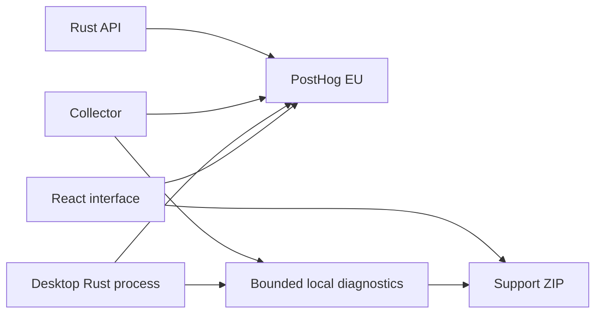

# Observability and support

Nauctions sends anonymous product events, error reports, and selected structured logs to PostHog EU. The desktop interface, desktop Rust process, collector, and API have separate reporting paths. Local diagnostics work when PostHog is unavailable.

## Key storage

The supplied `phc_` ingestion key is stored in the ignored root file `telemetry.local.json`. It is excluded from Docker build contexts. Local Vite and Rust builds read this file. Do not commit it.

An ingestion key must be present in distributed clients. A user can extract it from a build. It permits ingestion; it does not permit reading project data or managing the account. Never use a personal API key as the ingestion key. Both build configurations reject that mistake.

For GitHub release builds, set the repository secret `POSTHOG_API_KEY` to the ingestion key. The release workflow requires it. The automated attempt to store this secret on 29 October 2026 failed because GitHub CLI authentication returned HTTP 401. No repository secret was changed by that attempt.

For deployment, set `POSTHOG_API_KEY` in `deploy/.env`. Compose passes it to the browser build and server runtime. Set `NAUCTIONS_REVISION` to the deployed source revision. Do not pass a personal API key as a Docker build argument.

Remote reporting is off in debug Rust builds and Vite development/test runs. For a deliberate Rust verification run, set `NAUCTIONS_TELEMETRY=1`. Set it to `0` to disable native reporting. This does not remove local diagnostics. Production browser builds report when configured unless the user disables reporting.

## Captured data

| Channel | Data |
|---|---|
| Product analytics | App opened, screen viewed, successful API actions, crafting quote viewed, desktop actions, setup checks, diagnostics export |
| Error tracking | React render failure, unhandled JavaScript errors and rejections, API/network failures, native command failure, Rust panic, collector transport/acquisition failure, rejected upload, server worker failure |
| Remote logs | Fixed event/error codes, component, release, revision, incident or request ID, status, selected timings |
| Local support | Last 100 interface entries, two desktop diagnostic files, two collector diagnostic files, setup checks, queue counts, last staging/acceptance timestamps |

Product events use an anonymous installation identity. Nauctions does not identify a person by member ID, nickname, character, or email. Native operational events use service identities. Session replay, automatic click capture, form capture, console forwarding, and remote code loading are disabled. The network connection still exposes an IP address to the ingestion service; geographic enrichment is disabled for analytics.

Error messages can include private data. Remote reports use fixed failure codes. JavaScript reports retain sanitized stack frame locations. Native reports do not collect stacks, source filenames, or loaded module paths. They exclude original messages, request bodies, query strings, credentials, game file contents, and local personal paths. Source-map chunk IDs are retained when available.

Native events have a limit of one event per code per 30 seconds per process. Suppressed repetitions are not counted. Do not use remote event totals as exact failure rates. One native queue holds at most 128 records. Requests time out after 3 seconds and are not retried. Opt-out invalidates all queued records, including after reporting is enabled again. A request already in flight can finish. A shutdown or panic gets at most 2 seconds to drain the queue. A sudden process kill, access violation, or power loss can prevent a final report. These are not full native crash dumps.

Native local diagnostic files rotate at 1 MiB and retain one backup each. The original collector stdout/stderr logs remain available locally, but are not uploaded or included in the support ZIP. They can contain local paths.

## Help and diagnostics

Open **Help and diagnostics**, including before sign-in. Select **Check my setup** or **Export diagnostics**. The desktop export uses a Save dialog and writes a ZIP. The browser export writes a JSON file. A React render failure shows a recovery screen with these controls.

The desktop check reports the build, architecture, WebView2 version, addon version, free disk space, server health response, selected-folder existence, data-directory write access, bundled collector, collector state, queue counts, and transfer timestamps. It does not write game files, clear uploads, or reset pairing.

Use the reporting checkbox to disable outgoing usage, error, and log reporting for the desktop and collector. This stops the owned collector so the supervisor can restart it with the new preference. It does not change the automatic-collection preference or remove queued uploads. The server has its own operations setting.

When a friend reports a failure:

1. Ask for the build version, time of failure, visible reference, and diagnostic export.
2. Find the interface failure in the export. Use its `request_id` to find the server request, or its `incident_id` to find the PostHog report.
3. Check queue counts, last accepted upload, and setup flags before changing settings.
4. Use the existing retry, pairing, folder-selection, and collection controls for recovery. Keep pending uploads.
5. Reproduce the failure on the same release. Use its archived source maps or PDB files.

## Source maps and debug symbols

The build creates hidden JavaScript source maps. The production Docker image retains its exact maps under `/app/private-symbols`, outside the served web directory. Run `./scripts/export-web-symbols.ps1 -Image YOUR_DEPLOYMENT_IMAGE -Destination ./artifacts/symbols/deployed-web` before deployment. Use an empty destination. This exports maps from that exact image and records its image ID and map hashes. The `web-symbols` Docker target is also available for build-system exports. Do not serve or distribute this directory. Without upload credentials, it moves the maps to `artifacts/symbols/web/<version>-<revision>` and excludes them from the public web directory and installer.

To enable automatic source-map upload, set the repository secret `POSTHOG_PERSONAL_API_KEY` and repository variable `POSTHOG_PROJECT_ID`. The personal key needs error-tracking write access. The official Rollup plugin injects chunk IDs, uploads the maps to EU, and deletes them from the web build. The personal key is read only by the build plugin; it is never defined in browser code. Upload is not verified until these credentials are supplied.

Release builds keep native debug information. The desktop packaging script copies matching PDB files to `artifacts/symbols/native/<version>`. The release workflow retains the symbols artifact for 30 days. Download it when publishing a supported build and retain it with that build's revision and checksums. Do not distribute PDB files with the installer.

PostHog's Rust symbol uploader currently supports Linux and macOS, but not Windows PDB files. Use the retained Windows PDB files for local debugging. Automatic symbolication of Windows native reports is not available through this integration. See the [PostHog Rust symbol guide](https://posthog.com/docs/error-tracking/upload-source-maps/rust).

## Verify ingestion

Run `./scripts/test-telemetry.ps1`. It sends one synthetic product event, exception, and OTLP log to EU. It prints the HTTP results and a shared incident ID. It never prints the key.

On 29 October 2026, all three endpoints returned HTTP 200 for incident `3151ff42-13d6-431f-9b20-cc26e7e1f042`. HTTP acceptance does not establish that the records appeared in the dashboard. Open PostHog and find that incident to complete that check.

Local validation passed: 23 frontend tests; 19 collector tests; 20 server tests; one telemetry privacy test; 20 desktop tests; the production frontend build; Rust formatting; and strict Clippy checks for the affected crates. Three database integration tests and the signed-installer acceptance test require their separate environments and were not run for this change. The first collector run hit Windows sandbox file-replacement restrictions; the unrestricted rerun passed. Browser visual inspection was unavailable because the browser access host was unavailable. Real installation, update, and game trials remain open.

## Configure the dashboard

The ingestion key cannot create dashboards or alerts. Configure these in PostHog after signing in:

| View | Configuration |
|---|---|
| Active installations | Unique users for `nauctions.app_opened`, by day and release |
| Feature use | Count `nauctions.screen_viewed`, grouped by `screen` |
| Onboarding | Funnel from app opened to `nauctions.api_action_completed` with operation `auth/join`, then `nauctions.desktop_action_completed` with operation `pair` |
| Crafting use | Count `nauctions.crafting_quote_viewed` |
| Errors after release | Error Tracking issues filtered by `release` and `component` |
| Support logs | Logs filtered by `service.name`, `request_id`, or `incident_id` |

Set an alert for a new error after release and a sustained rise in failed uploads. Use an independent external monitor for API availability. A server that is down cannot send a report. Keep the production backup and restore checks in `release-validation.md`; telemetry does not replace them.

The current work does not deploy a server, publish a release, create account dashboards, configure an external uptime service, or complete the real-computer release trials.
