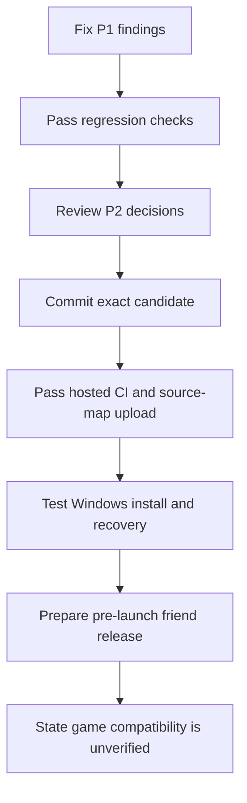

# Pre-launch release audit — 29 October 2026

Decision: do not publish the current candidate. Five P1 findings need fixes before distribution. The audit also found P2 recovery, data-quality, notification, and support issues.

This is a pre-launch software audit. The game is not available. Actual game compatibility remains unverified and is not presented as work that can be completed now. A future pre-launch release can state this limitation. It must still pass the checks that are available without the game.

## Remediation — 29 October 2026

F01–F16 now have code fixes in the working tree. The original findings below describe the audited candidate before these fixes. This update does not approve a release or claim game compatibility.

| Findings | Change | Regression evidence |
|---|---|---|
| F01 | Desktop ZIP dependency is now 9.1.3. No advisory exception was added. | Support ZIP roundtrip, desktop compilation and dependency audit pass. |
| F02 | Browser logs use an application-owned final OTLP payload. The SDK log enrichment path is removed. Requests omit the referrer. | Complete payload test excludes invitation query values, fragment values, tokens and `url.full`. |
| F03, F06 | Native events and logs share one bounded queue. Native stack and module capture are disabled. There is no SDK retry worker. Opt-out invalidates queued work, including after reporting is enabled again. | Synthetic error/panic paths and queued-work generation tests pass. A request already in flight can finish. |
| F04 | Protected credentials, configuration and queue transitions commit in one SQLite transaction. Desktop and collector read this snapshot. Re-pairing assigns new upload IDs to retained pending payloads and queues them for resubmission. | Received → re-pair → restart → accepted test passes. The database roundtrip also checks that a second device does not duplicate canonical scans. |
| F05 | The desktop starts the collector suspended, assigns a kill-on-close Job Object, then resumes it. Collector commands hold an exclusive data-directory lock. | Forced parent termination kills the owned collector. Stop/reap and competing-lock tests pass. |
| F07, F15 | Market views refresh every 30 seconds and on focus. Freshness and depth expire from observation time. Demo views and history charts use the fixed replay clock. | Depth boundary, rendered freshness and rendered historical replay-window tests pass. |
| F08 | PATCH locks the rule row and requires `deleted_at IS NULL`. Evaluation and delivery exclude retired rules. | A real concurrent DELETE/PATCH regression returns 404 and leaves the rule retired. |
| F09 | Dispatch reads current notification preference. A cancelled pending delivery expires. | A real PostgreSQL regression opts out after a simulated HTTP 429 and checks that no second request is sent. |
| F10 | Acquisition and transport use separate threads and SQLite connections. Transport handles one request per cycle with a 5-second timeout. Acquisition also reconciles saved files in standby. | A synthetic session save is acquired while a local upload is stalled. |
| F11 | Recovery commands do not require an available game root. Transport continues from retained payloads. Sync still requires the source folder. | Status, rejection review and retry pass with a missing game root. |
| F12 | Desktop status includes authentication pause, acquisition errors, folder availability, rejection count, queue count and oldest pending age. Running collectors send health updates every five minutes. | Queue/authentication/acquisition tests pass. The interface reports absent or expired runtime health. |
| F13, F14 | Missing original item links stay unresolved. Recorded scans retain the API's expected count when rows are missing. | Lua 5.1 tests run the actual record and replicate-read code with unresolved links and missing rows. Completeness trust remains disabled. |
| F16 | Browser requests have a 15-second abort timeout. Startup and mutations show a retry state. | Stalled GET and POST tests time out and then succeed on retry. |

Other fixes:

- Valid zero money displays as `0c`.
- The production image retains exact web source maps outside the public web root. `scripts/export-web-symbols.ps1` exports them from the deployment image and records its image ID and map hashes.
- Password verification permits at most four concurrent Argon2 jobs. Request admission permits at most eight concurrent handlers before body extraction and applies a 30-second request deadline. Both limits have regression tests. These limits do not establish production capacity for a specific host.
- Listing parsing uses bounded field splitting. A malformed listing with one million comma separators is rejected.
- Documentation states that native event counts are sampled and native requests have no retry. Shared-history writes remain disabled.

Verification after remediation:

| Check | Result |
|---|---|
| Rust workspace tests | Passed, including 22 collector tests and three native telemetry tests |
| Strict Clippy | Workspace and desktop passed |
| Desktop tests | 23 passed; signed release-package test remains ignored |
| PostgreSQL integration | Three passed in isolated schemas in a new disposable container |
| Frontend tests | 29 passed |
| Frontend production build | Passed; existing bundle-size warning remains |
| Addon Lua harness | 16 passed |
| Synthetic two-contributor history roundtrip | Lua reload and Rust verification passed for both contributors |
| Dependency audits | npm reports zero vulnerabilities; Rust workspace and desktop passed; five existing desktop dependency warnings remain |
| Production Linux image | Built; restricted-role health/frontend/authentication smoke and exact-image source-map export passed |

Run hosted CI against the committed candidate before distribution. Fresh signed installation, update and full user-flow acceptance still require a release package. Representative market/host capacity, real-client scan completeness and cross-peer provenance remain unverified. Keep completeness untrusted and shared-history writes disabled. No production deployment or release publication was performed.

## Scope and revision

The user requested Sol 6.1 subagents for the main packages. Four `gpt-6.1-sol` reviewers inspected the current working files. The root reviewer checked release automation, deployment, dependency audits, and test evidence.

Base commit: `fc73fdb7a2b9b17235c9dd63ab69c14dbbb86b64`. The audited candidate includes uncommitted and untracked changes. The base commit alone does not identify this candidate. File hashes and working-tree status are retained in `artifacts/release-audit/`.

| Reviewer | Packages | Result |

|---|---|---|

| Sol 6.1 desktop reviewer | Desktop, collector, game-process | Confirmed lifecycle, pairing, recovery, and collection-status defects |

| Sol 6.1 server reviewer | Server, storage, migrations, domain, analysis | Confirmed alert-rule and notification defects; no separate confirmed defect in storage, domain, or analysis |

| Sol 6.1 web reviewer | Web, ahdb-format, addon | Confirmed telemetry, freshness, chart, formatting, and addon data-integrity defects; no additional confirmed parser blocker |

| Sol 6.1 telemetry reviewer | Shared Rust telemetry | Confirmed native path disclosure and incomplete opt-out |

| Root reviewer | CI, packaging, deployment, verification | Confirmed dependency-audit failure; production image and restricted-role smoke passed |

No application source was changed during this audit. Only this report and ignored audit evidence were written. No release was published, no server was deployed, and no real game file was changed.

## P1 findings — fix before distribution

### F01. The desktop dependency audit blocks release preparation

References: `desktop/Cargo.toml:14`, `.github/workflows/ci.yml:74`, `.github/workflows/release.yml:16`.

The desktop uses `zip` 2.6.1. The current RustSec audit reports `RUSTSEC-2026-0367`, `RUSTSEC-2026-0368`, and `RUSTSEC-2026-0369`. `cargo audit --file desktop/Cargo.lock --no-fetch --json` returned exit code 1. Release preparation depends on that check, so the draft release cannot pass its current pipeline.

The advisories concern archive extraction. Nauctions uses `ZipWriter` for support exports; this audit did not establish an exploitable extraction path in the app. The confirmed blocker is the dependency and CI gate. Do not describe it as a demonstrated privilege-escalation flaw in Nauctions.

Fix: move to a patched compatible ZIP implementation/version. RustSec lists versions at or above 9.0.0 as patched. Run the desktop export tests, build, and dependency audit again. Do not add a blanket advisory exception to make the pipeline green.

Evidence: `artifacts/release-audit/desktop-rust-audit.json`.

### F02. Structured browser logs disclose full invitation URLs

Reference: `web/src/telemetry.ts:46`.

The application sanitizes caller attributes in `logs.beforeSend`. The installed PostHog SDK then adds `location.href` as the OTLP `url.full` attribute. A supported URL such as `/?invite=CODE` therefore sends the invitation code in structured logs. The separate analytics-event filter does not protect this log channel.

Evidence: an offline reproduction used the actual application callback and installed SDK payload builder. It produced `url.full=https://example.test/?invite=AUDIT_DUMMY_CODE`. No network request or real key was used. The root reviewer reran it successfully.

Fix: remove or replace URL context at the final log-payload boundary. Add a regression test against the complete OTLP payload, including SDK-added attributes, query strings, and fragments.

Reproduction: `artifacts/release-audit/repro-posthog-url-leak.mjs`.

### F03. Native exception reports disclose personal installation paths

References: `crates/telemetry/src/lib.rs:48`, `crates/telemetry/src/lib.rs:193`.

The application allowlist filters custom properties. It does not filter the SDK-generated exception data. `posthog-rs` adds full loaded-module paths to `$debug_images.code_file` and source filenames to stack frames. Its Windows dependency obtains module paths through `GetModuleFileNameExW`. The installer uses a per-user location, so a native failure can disclose a path containing the Windows account name.

This finding is confirmed by the dependency source chain. It was not reproduced by sending a user's paths to PostHog. The behavior conflicts with the current observability documentation.

Fix: sanitize SDK-generated debug-image paths and frame filenames in a native send hook. Preserve safe module basenames and debug IDs where possible. If this cannot be verified before release, disable native stack capture until the filter exists. Test both error and panic payloads with synthetic personal paths.

Evidence: `artifacts/release-audit/native-telemetry-source-audit.md`.

### F04. Re-pairing strands uploads already marked received

References: `crates/collector/src/main.rs:540`, `crates/collector/src/main.rs:277`, `crates/server/src/auth.rs:389`, `crates/server/src/ingest.rs:151`.

Pairing creates a new device and replaces its credential. The server-keyed collector directory and its existing spool remain. A `received` row continues to poll its old upload ID with the new device credential. The receipt endpoint scopes the upload to the device and returns 404. The collector does not restore the row to a state eligible for resubmission. **Retry pending uploads** changes retry timing only.

Trigger: receive HTTP 202 for an upload, then select **Pair again** or re-pair after revocation. The payload stays retained but cannot complete through the normal retry path.

Fix: preserve the device identity during credential rotation, or migrate the spool explicitly when identity changes. Make retained received payloads eligible for safe resubmission. Commit the identity and queue transition together. Test received → re-pair → eventual acceptance without duplicate canonical data.

### F05. A desktop crash can leave an uncontrolled collector running

References: `desktop/src/collector.rs:75`, `desktop/src/main.rs:367`.

The desktop creates an ordinary child process. Cleanup runs only on normal application exit. No Windows Job Object with kill-on-close ownership or independent collector run lock is present.

Trigger: force-terminate or crash the desktop while the collector runs, then reopen the desktop. The old collector can survive, while the reopened app starts and owns a second collector. Pause, sign-out, Quit, and update control only the new child. The old process can keep reading/uploading and can hold the bundled executable open during an update.

This is confirmed by the lifecycle source and Windows child-process ownership behavior. This audit did not force-terminate the user's running app.

Fix: assign the collector to a Job Object with `JOB_OBJECT_LIMIT_KILL_ON_JOB_CLOSE`. Add a per-data-directory run lock. Test parent termination, restart, Pause, sign-out, and upgrade with disposable files and a test API.

## P2 findings

| ID | Finding and trigger | Reference | Required fix/check |

|---|---|---|---|

| F06 | Native opt-out does not cancel SDK events or prepared retries already queued. `SEND` affects new application calls and the OTLP worker, but not the SDK's independent worker; `flush` also drains without checking the preference. | `crates/telemetry/src/lib.rs:23`, `:105` | Stop and discard pending native SDK work on opt-out. Test a delayed retry after disabling reporting. A send hook alone does not cover already prepared retries. |

| F07 | Live views retain response-time freshness and depth eligibility indefinitely. Leave a fresh screen open beyond the server's 45-minute depth window; it still appears usable. | `web/src/market-ui.tsx:21`, `web/src/main.tsx:119`, `web/src/Detail.tsx:26`, `web/src/Strategy.tsx:61` | Refresh on focus and at an interval. Expire live freshness and depth from observation time. Keep demo replay time fixed. |

| F08 | A concurrent PATCH can reactivate a deleted alert rule. PATCH reads enabled=true; DELETE retires it; PATCH writes the stale enabled value without a deleted-at condition. The hidden rule still qualifies for evaluation. | `crates/server/src/api.rs:147`, `:160`, `:170`; `crates/server/src/worker.rs:390` | Use an atomic conditional update or row-lock transaction. Exclude retired rules from evaluation and dispatch. Add the concurrent edit/delete regression. |

| F09 | Notification opt-out does not cancel queued delivery. A pending or rate-limited delivery can still send after notify becomes false. | `crates/server/src/worker.rs:511`, `:516`, `:537` | Check current notify state before dispatch and expire cancelled deliveries. Test opt-out after a simulated 429. |

| F10 | Stalled transport can hide an entire game session. Twenty serial requests with 30-second timeouts share the loop with game detection and file acquisition. After a session occurs between samples, the gate can remain in standby. | `crates/collector/src/main.rs:262`, `:671`, `:715`; `crates/game-process/src/lib.rs:45` | Separate acquisition from transport, bound transport cycles, and reconcile saved files in standby. Simulate a complete session during stalled uploads. |

| F11 | A moved or disconnected game folder blocks spool-only commands and upload recovery. All commands canonicalize the saved game root before dispatch. | `crates/collector/src/main.rs:467` | Permit status, rejection review, retry, and transport when the game root is unavailable. Require it only for acquisition and sync. |

| F12 | A running but failed collector can appear healthy. Authentication pause and acquisition/quota failures do not reach the desktop status. Normal desktop collection also never sends the CLI-only heartbeat. | `crates/collector/src/main.rs:297`, `:697`, `:628`; `desktop/src/collector.rs:178`; `web/src/DesktopShell.tsx:50` | Expose persistent acquisition/authentication/quota errors, queue age, and rejection counts. Send periodic bounded health updates. |

| F13 | An unresolved auction link can become an exact base-item record. The addon substitutes the base item link when the original link remains unavailable. A suffix/variant can then contaminate base-item prices and crafting inputs. | `addon/AuctionDB/Record.lua:122`, `:59`, `:84` | Keep identity unresolved; exclude or downgrade the observation. The offline Lua reproduction produced `i123!/2,1,,50,` after original-link failure. |

| F14 | Missing replicate rows lose partial-scan evidence. The addon obtains the API row count, skips rows with no item ID, then declares only the copied count. API count 2 with one unavailable row becomes a matching one-row record. | `addon/AuctionDB/Scan.lua:145`, `:158`; `addon/AuctionDB/Record.lua:84` | Preserve the expected count or record cancellation/partial status. Keep completeness distrust enabled until interrupted-read tests pass. |

| F15 | Replay charts use the device clock while history queries use the replay clock. A replay more than 24 hours old can place default history points outside the visible plot. | `web/src/Detail.tsx:111`; `crates/server/src/read.rs:608` | Pass replay/API as-of time to the chart. Add a rendered replay-window test. |

| F16 | Browser API requests have no timeout. A stalled session request leaves startup waiting; stalled mutations leave controls busy. | `web/src/api.ts:74` | Add an AbortSignal timeout and a usable retry state. Test stalled startup and mutation requests. |

F08 and F09 were reproduced with the exact SQL/guard logic against all six migrations in isolated schemas inside rolled-back transactions. No webhook was called.

F13 and F14 were reproduced with synthetic Lua 5.1 API mocks. They do not prove the behavior of the unreleased game API. They demonstrate how the addon handles missing data. `TRUST_RECORDED_SCAN_COMPLETENESS=false` limits the effect of F14. Do not enable trust until the expected-count defect and real-client validation are resolved.

## Lower-priority findings and risks

- **Zero money displays as missing data.** `web/src/market-ui.tsx:11` suppresses valid zero values. An exact breakeven scenario can display an em dash while ROI says 0%. Show `0c` for valid zero values. Reference: `web/src/Strategy.tsx:68`.

- **Production web source maps are not retained by the Docker build.** Vite moves them to `/src/artifacts/symbols`, but `deploy/Dockerfile:26` copies only `web/dist` into the final image. The Docker build does not configure source-map upload either. Add a secure upload/export step for the exact deployed web build. Desktop release retention is a separate path.

- **Login work has no in-flight bound.** `crates/server/src/auth.rs:154` admits up to 300 password checks per minute, then starts Argon2 work without a semaphore at `:165`. A synchronized burst can require approximately 5.6 GiB of password-work memory. This was not load-tested. Add bounded concurrent password work and test the intended host size.

- **Buffered request concurrency has no bound.** Upload authentication follows body buffering at `crates/server/src/ingest.rs:64`. The 32 MiB request limit does not limit the number of simultaneous bodies. Set and test concurrency limits.

- **Capacity limits need representative data.** Terminal staged bytes count toward the device quota until cleanup. Market read limits can reject a broad query before pagination. These are documented policies, not newly demonstrated defects, but synthetic small markets do not establish operating capacity.

- **Malformed listing strings can amplify parser memory.** `crates/ahdb-format/src/lib.rs:459` collects comma fields before checking the expected field count. Use bounded splitting and measure peak memory for maximum-size malformed strings.

- **Cross-peer provenance remains unverified.** `addon/AuctionDB/Comm.lua:283` shares history without the sync marker. Test peer sharing and compaction before enabling writes. This audit did not demonstrate a production feedback loop. Shared-history writes remain disabled.

- **Native telemetry counts are sampled.** The shared package suppresses each code for 30 seconds without retaining a count. Do not use these counts as exact failure rates. The SDK flush also does not guarantee delivery of final OTLP logs from short-lived commands.

The fixed friend invitation was previously accepted by the user. This audit does not reopen that product decision. The production access boundary must still match the intended audience.

## Verification performed

| Check | Observed result |

|---|---|

| Rust workspace tests and strict Clippy | Passed; three database tests run separately |

| PostgreSQL integration | All three passed in isolated schemas |

| Desktop tests and strict Clippy | 20 passed; signed-package acceptance test requires a release package and was not run |

| Rust formatting | Workspace and desktop passed |

| Frontend tests and production build | 23 tests passed; build passed with a bundle-size warning |

| npm advisory audit | Zero vulnerabilities reported |

| Rust workspace advisory audit | Zero vulnerabilities reported |

| Desktop advisory audit | Failed: three ZIP advisories; four unmaintained warnings and one unsound warning also remain |

| Addon harness | 14 synthetic tests passed |

| Synthetic history roundtrip | Lua test and Rust verification passed for both synthetic players |

| Production Linux image | Built successfully with the current Dockerfile |

| Restricted-role container smoke | Passed: health 200, frontend 200, unauthenticated API 401, UID 10001, six migrations applied under market_app |

| Temporary resource cleanup | Only the newly created smoke-test containers and network were removed |

| JavaScript telemetry URL reproduction | Confirmed offline with dummy data and no network |

The image was tested with a read-only root filesystem, no Linux capabilities, and no-new-privileges. `market_app` had no superuser, database-creation, role-creation, replication, or row-security-bypass privilege. The smoke used a disposable synthetic market, fresh random credentials, and remote telemetry disabled. No existing application data was changed.

Local image: `nauctions-first-release-audit:local`. Manifest-list digest: `sha256:2fb359d892249dc6c27464bc3c924caf8ea0f3ccbd409cb90501a7236d01769e`.

## Evidence and release order

Ignored evidence is under `artifacts/release-audit/`: Rust advisory JSON, source hashes, working-tree status, the offline URL reproduction, the native telemetry source proof, and the disposable-container smoke script. These files contain no production credentials. Retain the evidence with this candidate; do not treat the base Git commit as proof of the uncommitted candidate.

Fix the P1 findings and add their regression checks. Review the P2 list before the first friend pilot. Then commit the exact candidate and run hosted CI, including dependency checks and source-map upload. The user reports that all three PostHog values were added to GitHub. Their presence and permissions were not independently verified because GitHub CLI authentication previously returned HTTP 401.

Perform fresh Windows installation and update/recovery tests that can use synthetic files. Keep collection read-only and completeness untrusted. State that actual game compatibility is unverified. No game trial is required to claim that these synthetic checks passed; no synthetic check can claim game compatibility.

