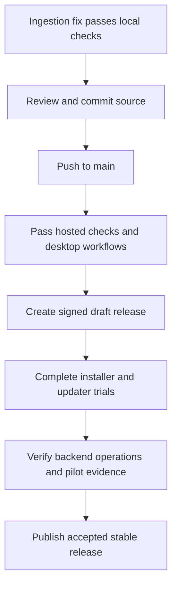

# First release audit — 29 October 2026

Decision at audit start: do not publish the first stable release yet. The local software passed the checks listed below. GitHub had no source commit, workflow run, or release. Read the follow-up record at the end for subsequent work. Installation, update, production, and real-game acceptance are still pending.

## Scope and evidence

This audit covers repository state, release workflows, updater signatures, desktop transport and credentials, collector persistence and write controls, parser and analysis tests, API ingestion and permissions, migrations, deployment files, and backup procedures. It combines source review with local automated checks. It does not establish that every source line is free of defects.

All checks used synthetic data or disposable database schemas. No real game file was changed. No GitHub release was created or published. The open desktop process was left running. Docker Desktop and the existing development PostgreSQL service were started for validation.

At audit start, the local branch had no commits and all project source was untracked. Thus, `git diff` could not show the initial project changes, and no immutable release revision existed.

Initial GitHub checks against `brunohanss/Nauctions` found:

| Check | Result |
|---|---|
| Repository | Exists; public; empty |
| Releases, including drafts | None |
| Actions runs | None |
| Release signing secret | `TAURI_SIGNING_PRIVATE_KEY` exists |
| Source deployed to `main` | No |

The earlier statement about pushing reviewed source and preparing a draft described intended work. It did not describe completed deployment. A signing secret alone does not make the release system operational.

## Defects corrected during this audit

### High: malformed metadata could stop ingestion

Evidence: `crates/server/src/worker.rs`, `process_upload`; regression coverage in `crates/server/src/tests.rs`, `exercise_invalid_metadata_queue`.

Before the fix, an item name with an escaped NUL character passed the Lua parser. PostgreSQL then refused the text or JSON value. The transaction rolled back, but the upload stayed `received`. The worker selected the same oldest upload again. A separate valid upload could not advance. A disposable PostgreSQL test reproduced three consecutive failures with both uploads still pending.

The fix keeps the upload row lock in an outer transaction and runs normalization inside a savepoint. A PostgreSQL data exception rolls back every write from that payload. The outer transaction records `rejected` with `invalid_saved_variables`. It retains the staged bytes under the existing retention policy. The next upload can then run. Connection and other operational errors still roll back and return an error for retry.

The error classification uses SQLSTATE class 22, which PostgreSQL defines as a data exception. It does not match localized error messages. See the [PostgreSQL error-code reference](https://www.postgresql.org/docs/16/errcodes-appendix.html).

Regression checks cover NUL characters in a name, a later item link, and the locale. They verify rollback of earlier catalog changes, an accessible rejection receipt, retained staged bytes, acceptance of the next valid upload, and unchanged scan counts on replay. A simulated connection exception verifies that valid data remains `received` and succeeds after the error is removed.

No schema migration or API format change is required. This fix does not add a general quarantine system for unrelated database corruption, configuration errors, or worker panics.

### Low: release preparation checks

- Corrected the collector test formatting that would fail the Rust formatting gate.
- Changed the manifest script's Git revision lookup to use `--verify --quiet`. This allows its documented uncommitted-build fallback to run without a terminating native-command error in Windows PowerShell.

## Local verification

| Check | Result |
|---|---|
| Rust workspace tests | 83 passed; two database tests run separately |
| PostgreSQL integration | Both passed, including the new ingestion regression cases |
| Workspace formatting and strict Clippy | Passed |
| Desktop tests | 12 passed |
| Desktop formatting and strict Clippy | Passed |
| Clean `npm ci`, frontend tests, frontend build | Passed; 17 tests |
| Demo-data tests | Five passed |
| npm advisory audit | Zero vulnerabilities reported |
| Rust advisory audits | Passed; desktop warnings listed below |
| Windows release packaging | Signed 0.4.0 installer built locally |
| Actual installer signature | Verified against the public key shipped in the app; a changed version was rejected |
| Manifest generation | Passed; revision is `uncommitted-local-build` |
| Production Linux image after the ingestion fix | Build and runtime smoke test passed |

Some sandbox runs denied child-process startup or Windows file replacement. The affected checks were repeated outside the sandbox and passed. The ordinary desktop build also encountered the running release executable. Packaging passed in a separate target directory without stopping that process. A clean npm install was rerun successfully after Tauri released its CLI file lock.

The final Linux image started as UID 10001 with a read-only root filesystem, no capabilities, and `no-new-privileges`. It applied migrations in a temporary schema, passed the health check, refused an unauthenticated item request with 401, and served the bundled frontend. The test container and schema were removed. The local image is `nauctions-release-audit:local`, with manifest-list digest `sha256:3a33f0a8523097e90a5059a049a74f1e08c47957549ba911badb7197b0463065`. This smoke test used the disposable database maintenance user; production-role acceptance remains a separate gate.

The desktop dependency audit reports allowed warnings for `proc-macro-error`, `zbus_names`, `zvariant`, `zvariant_derive`, and `glib`. These include maintenance and soundness warnings. Review their platform reachability and available upstream updates. The audit did not report a blocking vulnerability.

Local candidate files are in `artifacts/desktop`: the installer, signature, checksum, `latest.json`, and `release-info.json`. The installer SHA-256 is `98bcecf7f52f6f8563973492ed2a3b6b092867a9108cf0a91258d80741ff3697`.

The updater signature is valid. The installer has no Windows Authenticode signature. These are separate mechanisms. This local candidate has no committed source revision and is not a published release. The ingestion fix is in the backend; deploying the desktop installer alone will not deploy that fix.

## Open release gates

### 1. Source and GitHub automation

Create a reviewed source commit, push it to `main`, and run both `checks` and `desktop` for that exact revision. Then run `prepare desktop release` to create a signed draft. Verify the uploaded artifacts and revision record. Local checks cannot prove that hosted CI or access to the signing secret works.

The stable updater URL currently has no published manifest. Until a stable release exists, the application reports that update checks are unavailable. A draft does not activate that endpoint.

### 2. Installation and update acceptance

Complete `release-validation.md` on disposable Windows systems. Verify a fresh installation, a version-to-version upgrade, an actual in-app update, restart behavior, settings and pairing retention, and pending-upload retention. Include interrupted downloads, an unavailable endpoint, and invalid signatures.

The CI installer smoke test is defined but has never run on GitHub. This audit built and verified the installer; it did not install it on the user's active Windows profile. Automated signature tests do not establish successful installation or upgrade.

### 3. Backend operations

No production API endpoint, host configuration, public HTTPS check, external monitor, scheduled offsite backup, or production restore evidence was supplied. The application requires a shared reachable API and PostgreSQL service. GitHub hosts the source and updater files; it does not host this backend through the current workflows.

Before launch, record the deployed backend revision, migration version, access restrictions, backup schedule, verified offsite copy, and a restore drill. Run the final service under its restricted application database role.

### 4. Sustained collection and game compatibility

The 48–72 hour synthetic trial, real-client validation, and two-player pilot remain pending. Do not infer compatibility from the fixture tests. Keep scan completeness untrusted until the live checks pass.

Shared-history writes remain disabled in the CLI and desktop. Existing recovery findings in `ahdb-sync-audit.md` therefore block restoring writes, rather than automatically blocking a read-only pilot. Keep this limitation explicit in release notes. Do not distribute an older installer with write sync enabled as the initial supported version.

## Other findings and operating assumptions

### Fixed invitation code

The user has chosen to retain the current friend-join flow. The fixed code is visible in public source. Its practical risk depends on network access to the API. A service restricted by a VPN, firewall, or private network has an access boundary. An unlisted internet URL does not provide the same boundary. The Origin check does not authenticate a non-browser client.

This is an operating assumption to document, not an unrequested change to onboarding. Confirm the actual network boundary before describing the market as private.

### Medium: desktop settings recovery

`Desktop::save` writes `desktop.json` directly. Startup returns an error if that file is truncated or invalid. An interrupted write can therefore prevent startup and hide saved preferences. Source review found this path; this audit did not inject a crash during the write. Use atomic replacement, retain a known valid backup, and provide a recovery path in a later hardening change.

### Medium: collector capacity and diagnostics

Rejected payloads count against the 256 MiB spool budget. The error tells the user to clear rejections, but no supported cleanup command or desktop action exists. Accepted receipt rows also have no pruning policy. The collector log rotates only when the process starts, so a continuously running process can exceed its nominal log threshold. Define explicit reviewed cleanup and continuous log rotation before a long unattended rollout.

### Operational checks

The backup and restore scripts use encryption, checksum checks, and a new restore target. The repository contains an earlier local restore record. This audit did not repeat an offsite transfer or a restore with production credentials. Container images and Actions use version tags; record tested image digests when preparing deployment. Preserve the release signing key in an independent private backup before distribution.

## Release order

Keep each pending gate open until there is an observed result. Do not publish the stable release merely because packaging succeeded.

## Hardening follow-up — 29 October 2026

The user accepted the fixed invitation code and requested parallel release preparation while another agent builds the recipe cost simulator. Publication remains blocked on that feature and the open acceptance gates.

Implemented:

- Atomic desktop settings replacement, a valid backup, recovery after a damaged or missing primary, and a paused fallback if both copies are damaged. Damaged files are retained.
- Continuous desktop log rotation with one backup, at most 5 MiB per file. Both collector output pipes remain drained after a log write failure.
- Reviewed rejection cleanup by exact upload ID, checksum, and explicit confirmation. Pending uploads and source deduplication remain protected.
- Thirty-day retention for accepted and explicitly discarded receipts, with hourly cleanup. Unreviewed rejections retain their bytes.
- Installed-app settings recovery in the disposable Windows smoke script, manually runnable CI workflows, and actual-package signature verification before draft creation.
- A separate desktop target directory option so builds can run while the original release executable is open.

Local hardening tests and strict lint checks passed. Hosted workflow and package results are recorded after the baseline push. A local package or a hosted artifact is not acceptance of the pending version-to-version, in-app update, sustained collection, or real-game trials.
