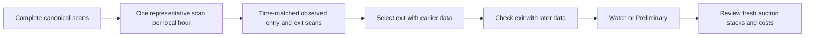

# Strategy tab

Status: first local implementation. Route: `/strategy`.

The Strategy tab identifies research candidates from observed asking prices. It covers weekly cycles, intraday recovery, and market dumps. It does not confirm sales or estimate sale probability. All signals remain Watch, Preliminary, or Insufficient data. None is labelled Actionable.

## User flow

1. Open Strategy. If a pattern is detected, select Any period, A few hours, or A few days. Hours means up to 24 hours; days means more than 24 hours, up to the model's 164-hour limit.
2. Use item search to narrow the market. Results use 20 rows per page.
3. Select Review to open the strategy detail. Read ENTER (price limit), HOLD (observed time range), and EXIT (historical price target and approximate dates if entering at the read clock). A clear wait state applies when the price or evidence does not qualify.
4. Inspect the visible historical price chart. ENTER and EXIT markers identify actual scans from the latest matched historical example, not executed trades or forecast prices. Select another example to inspect earlier comparisons, including losses. Use Last pattern, 7 days, 30 days, or All history to change the chart period.
5. Open Optional: calculate a purchase only when needed. Enter budget, maximum quantity, price limit, fee, and deposit assumptions to review whole stacks and conditional profit.
6. Recheck the game listings before a purchase. Record your own maximum holding time before entry.

## Evidence rules

- Use up to 90 days of complete full-scan observations. Demo scans are permitted only in the demo market.
- Exclude future data, zero prices, incomplete scans, and imported daily summaries.
- Give each local calendar hour one vote. Select the scan nearest the half-hour mark, with earlier timestamps as the first tie-break. Keep its actual timestamp, price, and quantity together. Repeated identical scans cannot change the representative. Missing hours stay missing.
- Use Europe/Paris for calendar dates and entry times. Combine the repeated autumn clock hour into one hourly vote. Use UTC timestamps for elapsed holding time across DST transitions.
- Split history by calendar time: the earlier two thirds select an exit; the later third checks it. Exclude training pairs whose exits cross the split. Do not use the current local day as a historical pair.
- Select one entry per historical date within two hours of the current local clock time. Use the nearest time, with the earlier timestamp as the tie-break. Weekly entries must also match the current weekday. Test target delays from 4 to 164 elapsed hours, in four-hour steps.
- Intraday entries use the same time matching across observed dates. Test target delays from 4 to 20 elapsed hours. Match the nearest observed exit within one hour of targets up to 24 hours, or within three hours for longer targets. Reject exits beyond 24 elapsed hours for intraday models or 164 hours for weekly models. Never reuse an exit within one candidate model. Do not interpolate across gaps.
- Report the lower median actual elapsed holding time from training pairs, rounded to the nearest hour. Later observations cannot change this estimate or the historical target.
- Require two training pairs before a seasonal model can be displayed. Mark the pattern as detected only when its median training gross increase exceeds 10%.
- Watch requires at least two later pairs, at least 75% of those pairs above a 10% gross increase, and at least seven observed dates. Weekly Watch also requires at least four usable pairs and 28 observed dates. These checks are exploratory thresholds, not statistical proof.
- A Review entry action also requires a fresh complete current observation, a positive buyout, and a current minimum at or below the training entry reference. Fresh means at most 45 minutes old. A missing, stale, or incomplete current observation cannot pass this action gate.
- Historical targets use training exit prices only. The target is their lower median. The conservative reference is their minimum. Neither is a sale forecast or a statistical confidence bound.
- A dump requires at least three prior dates with two observed hours per date in the last seven days. The latest median price must be at least 20% below the median daily reference, and supply must be at least twice the median daily quantity. A dump produces Monitor recovery, not a purchase instruction. It has no recovery target or holding-time estimate.

The main detail shows a median asking-price chart with observed gaps, price inspection, historical ENTER/EXIT markers, and dashed entry/exit references. Lines connect observations only when they are at most six hours apart. Historical examples include every usable training and later pair; the UI selects the latest entry by default without filtering for gains. Holding ranges are the minimum and maximum training durations, rounded outwards to whole hours. They are not forecast confidence intervals. The API retains the weekly heatmap cells for other uses. The main table shows detected patterns only. Strategy and evidence filters are not displayed. When no pattern is detected, display only "No profitable strategy yet" below the page heading, without table headers, pagination, or coverage controls. This empty-state label does not change the gross-price detection rules or confirm net profitability.

## Trade calculation

The calculator uses the existing authenticated listing-depth endpoint. Fresh, complete depth is required. Sort stacks by exact unit cost. Select the cheapest eligible whole stacks that fit both the budget and the manual quantity cap. Do not split stacks or multiply all units by the minimum price. This is a greedy stack selection, not a global packing optimizer.

Prices, costs, and scenario profits use integer or rational arithmetic. Gold inputs allow four decimal places. Fee inputs allow two decimal places. Fee and deposit assumptions have no default. The user must enter them explicitly; zero is permitted. Apply deposit losses once to the entire simulated trade.

Conditional profit = proceeds at the historical target after the entered fee − selected stack costs − entered deposit losses.

The scenario assumes all selected units sell at that reference. It is not probability-weighted expected profit. The quantity cap is a user input, not a recommended resale quantity. No maximum sale volume is inferred from disappearing listings.

## API

`GET /v1/strategies?market_id=...&q=...`

The endpoint requires a member session and the configured market. It returns item metadata, three pattern records per item (including actual historical pairs and training holding ranges), weekly heatmap cells, the read clock, method version, and `liquidity: unknown`. It reuses canonical scan records rather than contributor counts. Queries fail explicitly above 2,000 items or 50,000 historical observations. Narrow item search if a bound is reached; do not silently truncate history.

The browser filters and pages this bounded result. Sorting uses later price checks, historical gross change, or holding period. Net-profit ranking remains deferred until the system has suitable liquidity estimates and configured execution costs.

## Validation and limits

Unit tests cover sparse coverage, duplicate hours, future and zero-price exclusion, the autumn DST transition, later validation failure, target isolation from later data, stale entry suppression, and dump conditions. Frontend tests cover whole stacks, capital and quantity limits, exact large values, fees, and deposit losses. PostgreSQL tests cover authentication, market binding, complete-source selection, and the API response.

The synthetic launch-market demo covers 63 days with 701 irregular scans. It includes positive weekly and intraday controls, failed later validation, stable-price controls, and market dumps. The model can use individual scans when their times meet the matching tolerances. Run `scripts/verify-demo-strategies.mjs` to check the actual Rust results across eight sampling variants. See [demo-market.md](demo-market.md) for generation and API checks. Signal and validation thresholds are unchanged.

Use [strategy-datasets.md](strategy-datasets.md) to generate and inspect a separate synthetic JSON fixture. This format is for the analysis harness; it is not an AHDB upload format.

Missing observations reduce usable pairs. Evening-only collection cannot establish morning behavior. Hour balancing limits scan-frequency bias, but does not correct time-of-day selection bias or prove market-wide coverage. The reported observed dates and weeks are coverage diagnostics, not calibrated confidence scores.

Open work includes rolling walk-forward backtesting, multiple-comparison controls, market-regime changes, calibrated liquidity, stored plans, confirmed trade outcomes, group claims, cost configuration, and crafting metadata. The current split is a single chronological holdout, not a full backtesting framework. The model must be assessed on real Forever observations before its thresholds are treated as reliable.

Local API and automated checks passed. The Tauri 0.3.1 strategy detail was visually checked with the synthetic Linen Cloth intraday pattern: entry price, 7-9 hour holding range, exit price, dated window, and actual historical chart markers are visible. The optional calculator is collapsed. A dedicated mobile device check remains open.
